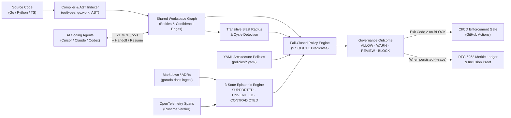

<p align="center">
  
</p>

<h1 align="center">Garuda</h1>

<p align="center">
  <strong>Let agents write. Garuda guards the architecture.</strong><br>
  <em>Garuda watches your architecture even when you aren't watching the diff — it maps, verifies, and gates every change before it merges.</em>
</p>

<p align="center">
  <a href="https://github.com/myshra777-ai/garuda/actions/workflows/ci.yml"></a>
  <a href="https://github.com/myshra777-ai/garuda/actions/workflows/garuda-ci.yml"></a>
  <a href="LICENSE"></a>
  <a href="PLAYBOOK.md"></a>
  <a href="EVIDENCE.md"></a>
</p>

<p align="center">
  <a href="#the-5-second-workflow">5-Second Workflow</a> ·
  <a href="#what-garuda-does-for-you">What Garuda Does</a> ·
  <a href="#why-the-graph-is-only-layer-1">The Moat</a> ·
  <a href="#put-the-gate-in-cicd">CI/CD Gates</a> ·
  <a href="#software-intelligence-instrument-dashboard">v1.4 Dashboard</a> ·
  <a href="#21-mcp-tools-for-coding-agents">21 MCP Tools</a> ·
  <a href="#evidence-not-false-certainty">Epistemic Honesty</a>
</p>

AI coding agents (Cursor, Claude Code, Codex, Devin) write code faster than humans can review it. A pull request can pass every unit test and linter check while quietly introducing a forbidden `Handler -> Database` dependency, creating a circular package dependency (`A -> B -> C -> A`), breaking a shared struct with 170+ downstream callers, or drifting away from documented ADRs and live production behavior.

**Garuda is a deterministic change-control gate and architecture intelligence platform for AI-written code.** It gives coding agents a compiler- and AST-backed map of your system *before* they edit, evaluates explicit YAML architecture policies against transitive blast radius and runtime OpenTelemetry evidence, and blocks architectural violations in CI *before* they merge.

## The 5-Second Workflow

Boot the entire local stack, index your repository, and wire up your coding agents in one command:

```bash
git clone https://github.com/myshra777-ai/garuda.git
cd garuda
./setup.sh
```

Or run the unified change-control gate against any symbol or pull request target:

```bash
./bin/garuda check \
  --project my-system \
  --target PaymentService \
  --policy ./policies \
  --save \
  --fail-on-block \
  --json
```

**Here is what happens immediately:**

1. **Compiler & AST Extraction (`100%` Local, Zero LLM Guessing)** — Garuda parses your workspace using `go/types` + `go.work` + `vendor/` for Go (exact type resolution across modules), Python ASTs, and Tree-sitter TypeScript ASTs. No source code leaves your machine, and there is no embedding or vector-store hallucination.
2. **Transitive Blast Radius & Topology Mapping** — Computes confidence-weighted downstream callers, interface implementers, structural hubs, and package cycles in milliseconds.
3. **3-State Epistemic Truth (`SUPPORTED` / `UNVERIFIED` / `CONTRADICTED`)** — Correlates static code edges with ingested Markdown/ADR requirements (`garuda docs ingest`) and live OpenTelemetry runtime spans (`POST /api/v1/telemetry/spans`). Shadow runtime calls that bypass static boundaries are automatically quarantined as `CONTRADICTED`.
4. **Fail-Closed Policy Evaluation (`ALLOW` / `WARN` / `REVIEW` / `BLOCK`)** — Runs 9 deterministic SQL/CTE policy predicates (`layer_violation`, `transitive_claim_exists`, `cycle_exists`, `blast_radius_exceeds`, `contradiction_exists`, `verification_missing`, `claim_exists`, `entity_exists`, `language_matches`). With `--fail-on-block`, a `BLOCK` verdict exits with code `2` to fail your CI pipeline.
5. **RFC 6962 Merkle Audit Receipt** — When persisted with `--save`, the governance decision and its exact input hashes are anchored in an append-only SHA-256 Merkle tree so any auditor or CI job can cryptographically verify inclusion and tamper-evidence.

## What Garuda Does for You

| Who You Are | What Garuda Does for You | How You Use It |
|---|---|---|
| **Software Engineers** | Shows every direct and transitive caller, interface implementation, and architectural rule before you refactor a shared struct or service. | Run `garuda impact`, `garuda check`, or inspect the **Change Review Workbench** in `/dashboard` and VS Code. |
| **Staff / Principal Architects** | Turns tribal architecture rules (clean layering, zero cycles, blast-radius caps, mandatory runtime trace coverage) into executable YAML policies enforced on every PR. | Commit policies in `policies/*.yaml` and enforce them with `garuda check --fail-on-block` in GitHub Actions. |
| **AI Coding Agents (Cursor, Claude, Codex)** | Replaces blind grep/RAG guessing with 21 deterministic MCP tools for symbol resolution, blast radius, policy pre-checks, and transactional multi-agent handoffs. | Call `garuda.briefing`, `garuda.blast_radius`, `garuda.verify_policy_evaluation`, `garuda.handoff`, and `garuda.resume`. |
| **Security & Governance Leads** | Preserves a tamper-evident ledger of every saved architecture decision, policy evaluation, and runtime contradiction with RFC 6962 Merkle inclusion proofs. | Inspect the **Governance & Audit Ledger** surface or call `GET /api/v1/decisions/{id}/verify-evidence`. |

## Why the Graph Is Only Layer 1

Tools like knowledge-graph indexers stop at building a graph to help agents browse files. **In Garuda, the graph is the shared foundation — the product is the deterministic change-control system built on top of it:**



- **Graph Indexers vs. Garuda Change Control:** A graph tells an agent *what exists*. Garuda tells the agent and your CI pipeline *whether a proposed change is allowed to ship* (`ALLOW`, `WARN`, `REVIEW`, or `BLOCK`), backed by compiler-grade static edges, runtime OpenTelemetry corroboration, and fail-closed policy predicates.
- **Edge-Level Runtime Contradiction Quarantine:** Static analysis alone misses dynamic dispatch and reflection. Garuda ingests OpenTelemetry trace spans and promotes a static edge to `SUPPORTED` only when **both** caller and callee match at runtime—while automatically creating a `CONTRADICTED` quarantine record whenever production traffic makes an undeclared cross-service or cross-layer call.
- **Fail-Closed Governance by Design:** Malformed policy YAML, unknown predicates, or persistence failures never silently pass (`ALLOW`). Garuda fails closed so broken guardrails cannot wave bad changes through CI.

## Put the Gate in CI/CD

Garuda provides three purpose-built CI gates so you can enforce the exact failure mode your team requires. Configure any of these commands as a required status check in GitHub branch protection to block non-compliant pull requests from merging:

| CI Gate | Command | What It Enforces | Exit Behavior |
|---|---|---|---|
| **1. Unified Change-Control Gate** | `garuda check --project <ws> --target <sym> --policy ./policies --save --fail-on-block --json` | Runs 5 planes in one command: Transitive Blast Radius + 3-State Evidence + YAML Policy Evaluation + Governance Outcome + RFC 6962 Merkle Receipt. | Exits `2` on `BLOCK` (`0` on `ALLOW`/`WARN`/`REVIEW`). |
| **2. Structural Regression Gate** | `garuda ci --baseline ./garuda-baseline.json --block-on-break` | Compares the current branch against a saved baseline snapshot to catch unintended signature breaks, removed exports, or structural regressions. | Exits non-zero when breaking structural changes are detected. |
| **3. Contradiction & Drift Gate** | `garuda ci check --fail-on-contradiction=true` | Verifies that documented architecture claims (`garuda docs ingest`) and runtime traces have zero active `CONTRADICTED` edges in the workspace. | Exits non-zero if any active contradiction exists. |

### Example Executable Architecture Policy (`policies/architecture-layer-guardrails.yaml`)

Garuda policies are explicit YAML files. There is no hidden magic. If a policy is malformed, the CI gate fails closed.

```yaml
id: architecture-no-api-to-store-bypass
version: v1
title: "API handlers must not bypass service layer to access store directly"
priority: 150
language: any
authority: "Architecture Review Board"
scope:
  domain: platform
  package: "internal/api"
when:
  - type: layer_violation
    params:
      from_layer: "internal/api"
      to_layer: "internal/store|database/sql"
then:
  decision: BLOCK
  reason: "API layer must route state mutations through domain/service interfaces rather than calling persistence packages directly."
```

Start with the included [architecture layer guardrails policy](policies/architecture-layer-guardrails.yaml) and the full [CLI & Policy Reference](docs/API.md).

## Software Intelligence Instrument (`/dashboard`)

Garuda v1.4 ships a redesigned, high-craft web instrument at `http://localhost:8080/dashboard` inspired by Linear, Vercel, Sentry, and Neo4j Bloom—replacing noisy full-graph hairballs with 6 focused engineering surfaces and a global `⌘K` / `Ctrl+K` command palette:

1. **Workspace Briefing (`/dashboard#briefing`)** — Clean status strip and health KPIs (Indexed Entities, Policy Posture, Active Contradictions, Merkle Ledger Head) paired with an actionable Needs-Attention queue and recent governance verdicts.
2. **Architecture Map (`/dashboard#map`)** — **Neighborhood-first 1-hop / 2-hop topology explorer** (`[Selected Caller] ──> [Focal Symbol] ──> [Direct Dependency / Policy Badge]`) with interactive hop-depth (`1 hop`, `2 hops`) and edge-kind filters (`Calls`, `Imports`, `Implements`, `Claims`) plus a synchronized 4-tab Inspector Drawer (`Source`, `Relationships`, `Policy Results`, `Evidence`).
3. **Change Review Workbench (`/dashboard#workbench`)** — 3-pane pre-merge simulator: select a target symbol and policy bundle on the left, inspect impacted callers and policy rules in the center, and generate a live `ALLOW` / `WARN` / `REVIEW` / `BLOCK` governance gate receipt on the right.
4. **Policies (`/dashboard#policies`)** — Interactive catalog of all 9 deterministic SQL/CTE policy predicates alongside a live YAML Policy Sandbox to test rules before committing them to CI.
5. **Contradictions & Evidence (`/dashboard#contradictions`)** — Sentry-style forensic queue for `CONTRADICTED` and `UNVERIFIED` claims, comparing static AST location against live OpenTelemetry runtime trace spans (`trace_id`, `span_id`, service pair) plus an interactive OTel Span Simulator.
6. **Governance & Audit Ledger (`/dashboard#ledger`)** — Append-only decision table with a bottom **Decision Record Inspector** (`What it did`, `What it looked at`, `What rule applied`, `Epistemic state`, `RFC 6962 Merkle Inclusion Proof`) and 1-click cryptographic verification.

## 21 MCP Tools for Coding Agents

`./setup.sh` automatically registers `garuda-mcp` with **Cursor** and **Claude Desktop** (and prints ready-to-paste config for **Codex CLI**). Connected agents query the shared workspace model directly via 21 deterministic tools:

| Category | MCP Tools | Purpose |
|---|---|---|
| **Orientation & Discovery** | `garuda.briefing`, `garuda.entities`, `garuda.find_entity`, `garuda.inspect` | Orient the agent to workspace health, resolve exact symbol IDs, and inspect source signatures before editing. |
| **Topology & Blast Radius** | `garuda.neighbors`, `garuda.blast_radius`, `garuda.get_impact`, `garuda.implementers`, `garuda.subclasses`, `garuda.query_claims` | Trace upstream callers, downstream dependencies, interface implementations, and transitive change impact. |
| **Governance & Policy Gates** | `garuda.verify_policy_evaluation`, `garuda.policy.evaluate`, `garuda.governance.status`, `garuda.policy.list` | Pre-check proposed refactors against active YAML policies and verify RFC 6962 Merkle receipts. |
| **Epistemic Truth & Runtime** | `garuda.detect_contradictions`, `garuda.check_drift`, `garuda.get_lineage`, `garuda.propose_decision` | Query static-vs-runtime contradictions, ADR drift, and decision history. |
| **Multi-Agent Continuity** | `garuda.handoff`, `garuda.resume` | Persist and resume structured multi-agent task state, pinned symbols, and architectural constraints across sessions. |

### Complete CLI Command Surface

Beyond `garuda check` and `garuda ci`, the `garuda` CLI includes dedicated workflows for daily architecture engineering:

- `garuda init <repo-path> --workspace <name>` — Initialize and index a repository into a named workspace.
- `garuda analyze <path>` — Run compiler-backed Go (`go/types` + `go.work`) and multi-language AST extraction.
- `garuda impact --target <symbol>` — Compute confidence-weighted transitive blast radius from the terminal.
- `garuda policy evaluate --policy <dir>` — Evaluate YAML architecture policies across the active workspace.
- `garuda docs <ingest|verify|status>` — Extract architectural claims from Markdown/ADRs and verify them against code.
- `garuda hygiene` (alias `garuda ponytail`) — Detect structural dead-ends, orphaned symbols, and architectural drift.
- `garuda topology` & `garuda summary` — Inspect package-level layering, hub centrality, and workspace metrics.
- `garuda plan` & `garuda dev` — Generate change plans and launch the local development control plane.

## Evidence, Not False Certainty

Garuda keeps the boundaries of its evidence explicit so teams never mistake a clean check for magical omniscience:

- **`SUPPORTED`** — Available static and/or runtime evidence corroborates the claim within the verified scope.
- **`UNVERIFIED`** — Static structure exists, but runtime or secondary corroborating evidence has not yet been observed. It does *not* mean the relationship is broken.
- **`CONTRADICTED`** — Available evidence actively conflicts with a claim (for example, an ADR states `ServiceA` never calls `StoreB`, or an OpenTelemetry span observes an undeclared runtime call).

**What the RFC 6962 Merkle Ledger Proves (and What It Doesn't):**
The Merkle ledger cryptographically proves the **inclusion, ordering, and tamper-evidence of persisted governance records** (`--save`). It does **not** prove that an unindexed dynamic call cannot exist, that a human-written YAML policy is wise, or that the software is bug-free. Preview evaluations run without `--save` are ephemeral and are not anchored to the ledger.

## Supported Languages & Verification Benchmarks

| Language | Analysis Engine | Confidence & Scope | Status |
|---|---|---|---|
| **Go** | `go/types`, `go/ssa`, `go.work`, `vendor/` | Exact compiler-grade type, interface, and cross-module call resolution (`1.0` static confidence). | **Production** |
| **Python** | Structural AST Analyzer | Module, class, function, import, and call-graph extraction. | **Beta** |
| **TypeScript** | Tree-sitter AST Analyzer | Interface, class, function, import, and structural relationship extraction. | **Beta** |

- **Reproducible Verification Suite:** `make benchmark-strict` executes 24 ground-truth compiler and cross-module benchmarks (`TestDoubleRunDeterminism` across all 24 cases), `38/38` reference MCP verifier checks (`scripts/mcp_verify.py`), and `10/10` edge-level runtime contradiction detections (`scripts/runtime_contradiction_test.py`). See [EVIDENCE.md](EVIDENCE.md) for full methodology and scope boundaries.

## Documentation

- **[Operational Playbook](PLAYBOOK.md)** — 1-command onboarding, MCP client wiring (Cursor, Claude Desktop, Codex), policy authoring, runtime OpenTelemetry ingestion, and troubleshooting.
- **[System Walkthrough](docs/WALKTHROUGH.md)** — End-to-end CLI, v1.4 Dashboard, MCP, and VS Code extension workflows.
- **[Capabilities & Verification Tiers](docs/CAPABILITIES.md)** — Detailed breakdown of production vs. beta capabilities and verification guarantees.
- **[CLI, Policy, MCP & HTTP API Reference](docs/API.md)** — Complete reference for all CLI flags, 9 policy predicates, 21 MCP tools, and REST endpoints.
- **[System Specifications](docs/SPECS.md)** — Architecture internals, PostgreSQL schema, Ed25519 JWT auth, and Merkle tree specifications.
- **[Verification Evidence](EVIDENCE.md)** — Reproducible benchmark output, test coverage, and explicit security/epistemic boundaries.
- **[Changelog](CHANGELOG.md)** · **[Codebase Hygiene](docs/hygiene.md)** · **[License (Apache 2.0)](LICENSE)**