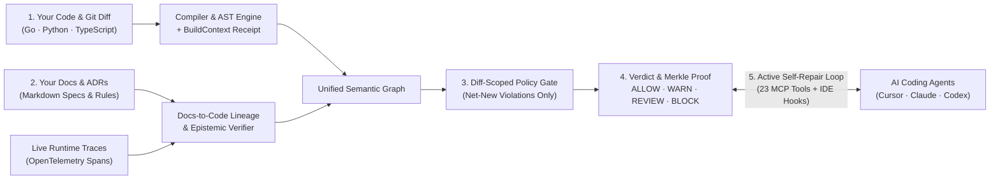

```markdown
<p align="center">
  
</p>

<h1 align="center">Garuda</h1>

<p align="center">
  <strong>AI writes code at 100 mph. Garuda makes sure your architecture survives the ride.</strong><br>
  <em>The local-first change-control gate, active AI agent harness (<code>Garuda Talon</code>), and visual software intelligence instrument for modern engineering teams.</em>
</p>

<p align="center">
  <a href="https://github.com/myshra777-ai/garuda/actions/workflows/ci.yml"></a>
  <a href="https://github.com/myshra777-ai/garuda/actions/workflows/garuda-ci.yml"></a>
  <a href="https://github.com/myshra777-ai/garuda/actions/workflows/garuda-gate.yml"></a>
  <a href="LICENSE"></a>
  <a href="LICENSE"></a>
  <a href="INSTALL.md"></a>
  <a href="EVIDENCE.md"></a>
</p>

<p align="center">
  <a href="#watch-the-20-second-cinematic-intro">20s Cinematic Demo</a> ·
  <a href="#the-story-why-we-built-garuda">Why Garuda Exists</a> ·
  <a href="#a-visual-tour-of-garuda">Visual Product Tour</a> ·
  <a href="#install-in-one-command-zero-dependencies">1-Command Install</a> ·
  <a href="#how-garuda-works-in-plain-english">How It Works</a> ·
  <a href="#documentation-suite">Full Documentation</a>
</p>

---

## Watch the 20-Second Cinematic Intro

Experience what Garuda is and how its **Software Intelligence Instrument** turns invisible code structure, architecture rules, and AI agent edits into a living control room:

<div align="center">
  <video src="assets/garuda_dashboard_demo_video.mp4" controls autoplay loop muted playsinline width="100%">
    <source src="assets/garuda_dashboard_demo_video.mp4" type="video/mp4">
    <a href="assets/garuda_dashboard_demo_video.mp4">
      
    </a>
  </video>
  <p><em>🎬 <strong>20-Second Product Introduction:</strong> If your browser blocks inline video playback on GitHub, <a href="assets/garuda_dashboard_demo_video.mp4"><strong>click here to play the video</strong></a>.</em></p>
</div>

---

## The Story: Why We Built Garuda

We are living through the biggest shift in how software is built. Today, coding agents like **Cursor**, **Claude Code**, **Codex**, and **Windsurf** can generate a thousand lines of working code in thirty seconds.

At first, it feels like magic. Tests pass. Linter checks turn green. The pull request looks clean.

**Then, six months later, your team hits a wall.**

Why? Because AI agents optimize for *making the local prompt work right now*—not for protecting the long-term shape of your system:

- **Silent Shortcuts:** Instead of going through your clean domain service, an agent makes an HTTP handler talk directly to the database repository (`CheckoutHandler -> OrderRepository`).
- **Tangled Knots:** Three packages quietly start importing each other in a circle (`auth -> billing -> users -> auth`).
- **Blind Edits to Core Hubs:** An agent changes a shared struct or function used by 170+ other places without checking what breaks downstream.
- **Forgotten Decisions:** Your team wrote Architecture Decision Records (ADRs) and design docs six months ago, but those Markdown files sit in a folder while code drifts in the opposite direction.
- **"It Passed on My Laptop, Why Did CI Break?":** What compiles cleanly on a developer's macOS laptop (`darwin/arm64`) quietly pulls in a forbidden dependency under Linux CI (`linux/amd64`) or a specific build tag.

**Linters check syntax. Unit tests check small functions. Neither guards your architecture.**

We built **Garuda** to be the missing seatbelt for the AI coding era. Instead of asking humans to manually police thousands of lines of AI-generated diffs, Garuda turns your architecture documents, layer rules, and system boundaries into an **active, self-correcting guardrail** that both humans and AI agents can see, query, and trust.

---

## What Makes Garuda Different

| Traditional Tools & Passive Code Graphs | How Garuda Works (`v1.8.1`) |
| :--- | :--- |
| **Passive:** Waits for a developer or AI agent to voluntarily ask a question. If the agent forgets to ask, bad code slips in. | **Active (`Garuda Talon`):** Automatically briefs Cursor, Claude Code, Codex, and Windsurf *before* they edit, verifies the diff *after* every edit, and hands the agent a plain-English **Self-Repair Prompt** if it breaks a rule. |
| **Docs & Code Live Apart:** Markdown ADRs and design specs rot in a folder while code does something else. | **Living Docs-to-Code Graph:** Ingests your Markdown ADRs, specs, and YAML policies and visually connects every written rule (`MUST` / `MUST_NOT`) directly to the exact code symbols it governs. |
| **Static Guesswork Only:** Assumes that if code isn't linked statically, services aren't calling each other. | **3-State Truth (`SUPPORTED` · `UNVERIFIED` · `CONTRADICTED`):** Cross-checks static code with your ADRs *and* live production OpenTelemetry traces to catch shadow calls in real time. |
| **Blames You for Legacy Debt:** Runs a noisy scan that dumps 500 old warnings on your PR so everyone ignores it. | **Diff-Scoped Precision:** Inspects only the exact symbols touched in your `git diff`—blocking **net-new violations** while keeping legacy baseline debt separate. |
| **"Works on My Machine" Blind Spots:** Ignores OS build tags, `CGO_ENABLED` flags, and compiler environment differences. | **Deterministic `BuildContext` Receipts & Cross-OS Matrix:** Seals the exact OS, architecture, build tags, and dependency hashes into a cryptographic receipt—and checks Linux, macOS, and Windows build profiles in one pass (`--matrix`). |

---

## A Visual Tour of Garuda

Garuda isn't just a terminal tool—it ships with a local, zero-cloud **Software Intelligence Instrument** (`/dashboard`) that works 100% offline in your browser or as an installable desktop/mobile app. Here is what you see when you open Garuda on your codebase:

### 1. Executive Workspace Briefing & Health Strip
The moment you open Garuda, you get a clean, calm pulse on your entire engineering system: how many entities and relationships are mapped, whether your architecture policies are passing, which high-risk symbols need attention, and the latest cryptographically sealed governance decisions.

<p align="center">
  
</p>

### 2. Explore Index & Instant Symbol Intelligence
No more grepping through hundreds of files. Garuda automatically surfaces your most critical exported structs, interfaces, functions, and packages ranked by real caller fan-in and blast radius, with instant search (`⌘K` / `Ctrl+K`) and one-click deep inspection.

<p align="center">
  
</p>

### 3. Neighborhood-First Architecture Map
Instead of dumping a chaotic "hairball" graph of 10,000 nodes on your screen, Garuda renders a clean **1-hop or 2-hop neighborhood map** around the exact package or symbol you are investigating—showing who calls it, what it depends on, and a synchronized 4-tab Inspector Drawer (`Source`, `Relationships`, `Policy Results`, `Evidence`).

<p align="center">
  
</p>

### 4. Docs, Specs & Guardrails Lineage Graph
When you ingest your team's Markdown ADRs, design specs, and YAML policies into Garuda, it builds a **4-tier visual lineage graph** that connects the dots from **Documents** → **Extracted Rules (`MUST` / `MUST_NOT`)** → **Active Policy Guardrails** → **Actual Code Symbols**, complete with an interactive Document-to-Code matrix and live in-browser ADR ingestion.

<p align="center">
  
</p>

### 5. Garuda Talon Active Harness, Risk Hub & Build-Context Matrix
See every active AI coding hook (`Cursor`, `Claude Code`, `Codex`, `Windsurf`, `Git Pre-Commit`), inspect your **Deterministic `BuildContext` Provenance Receipt** and **4-Target Cross-Platform Matrix (`linux`, `darwin`, `windows`, `cgo`)**, review the **Architectural Risk Hub Leaderboard**, and test live self-repair prompts in one place.

<p align="center">
  
</p>

### 6. Pre-Merge Change Review Workbench & Live Policy Sandbox
Before you or an AI agent merge a change to a core symbol, simulate the impact in the 3-pane **Change Review Workbench** or test new architectural rules live in the **YAML Policy Sandbox** to get an instant `ALLOW`, `WARN`, `REVIEW`, or `BLOCK` verdict.

<p align="center">
  
</p>

### 7. Forensic Contradictions Queue & RFC 6962 Cryptographic Audit Ledger
When code breaks an ADR rule or production OpenTelemetry traces reveal an undeclared runtime call, Garuda quarantines it in the **Contradictions & Evidence** view—and seals every committed check into a tamper-evident **RFC 6962 SHA-256 Merkle Audit Ledger** with one-click proof verification.

<p align="center">
  
</p>

<details>
<summary><strong>🔍 Click to view IDE Integration & Additional Workspace Views (VS Code / Cursor)</strong></summary>
<br>

| IDE Graph View | IDE Contradictions Panel |
| :---: | :---: |
|  |  |

<p align="center">
  
</p>
</details>

---

## Install in One Command (Zero Dependencies)

Whether you are a **Founder**, **Product Manager**, **Staff Architect**, or **Software Engineer**, you do **not** need Go, PostgreSQL, Docker, GCC, or Xcode pre-installed. Garuda provisions everything automatically in your user folder (`~/.garuda`) and launches in one command:

### macOS, Linux, Chromebook & Android (Termux)

```bash
# Option A: 1-Command Remote Install & Launch
curl -fsSL https://raw.githubusercontent.com/myshra777-ai/garuda/main/install.sh | bash

# Option B: Inside an existing cloned repository
git clone https://github.com/myshra777-ai/garuda.git && cd garuda && ./setup.sh
```

### Windows 10 / 11 (PowerShell — No Admin Required)

```powershell
# Option A: 1-Command Remote Install & Launch
Set-ExecutionPolicy Bypass -Scope Process -Force; irm https://raw.githubusercontent.com/myshra777-ai/garuda/main/install.ps1 | iex

# Option B: Inside an existing cloned repository
cd $HOME\garuda
powershell -ExecutionPolicy Bypass -File .\setup.ps1
```

### Need a Quick Health Check? Run `garuda doctor`

If your laptop reboots or anything ever feels out of sync, one command checks and auto-repairs your database, binaries, MCP configs, and IDE hooks:

```bash
./bin/garuda doctor --fix
```

---

## How Garuda Works in Plain English

Under the hood, Garuda coordinates **5 planes of software intelligence** so your architecture stays clean without slowing your team down:



### Your Day-to-Day Workflow in 4 Simple Commands

```bash
# 1. Index your codebase and seal a deterministic BuildContext & Merkle baseline
./bin/garuda analyze . --workspace default --save

# 2. Ingest your team's Markdown ADRs & design specs into the Docs-to-Code Graph
./bin/garuda docs ingest ./docs/adr --workspace default

# 3. Check blast radius and governing rules before touching a critical symbol
./bin/garuda talon brief CheckoutHandler --workspace default

# 4. Gate your uncommitted changes (and optionally test across Linux/macOS/Windows build targets!)
./bin/garuda talon guard --workspace default --matrix --fail-on-block
```

If an AI agent or developer introduces a forbidden dependency, Garuda stops the bad change before it lands and prints a concrete **Self-Repair Prompt** showing the exact file, line number, violated rule, and how to fix it cleanly.

---

## Built for Every Person on the Team

- **For Founders & Engineering Leaders:** Open `http://localhost:8080/dashboard` to see an honest, visual health scorecard of your architecture, high-risk coupling bottlenecks, and cryptographic proof that AI-generated code respects your engineering standards.
- **For Software Engineers:** Know the exact blast radius of any struct, class, or function before you edit it—and run `garuda check --diff HEAD` so you are only ever accountable for your own diff, never blocked by old legacy code.
- **For Staff & Principal Architects:** Write rules once in plain Markdown ADRs (`MUST` / `MUST_NOT`) or declarative YAML policies, and watch Garuda enforce them automatically across Cursor, Claude Code, Git pre-commit hooks, and CI/CD.
- **For AI Coding Agents (`Cursor`, `Claude Code`, `Codex`, `Windsurf`):** Instead of guessing with `grep`, agents receive your workspace's architectural contract on their very first MCP call and use 23 deterministic tools to self-verify and self-repair their code.

---

## Documentation Suite

We keep this `README` clean and human-friendly while providing exhaustive, production-grade technical depth in dedicated guides:

| Document | Audience | What You'll Find Inside |
| :--- | :--- | :--- |
| **[`INSTALL.md`](INSTALL.md)** | Everyone (PMs, Founders, Engineers) | Step-by-step 1-command zero-dependency setup for Windows, macOS, Linux, Chromebook, and Android + 13-item troubleshooting reference. |
| **[docs/WALKTHROUGH.md](docs/WALKTHROUGH.md)** | Engineers, Architects & Evaluators | Visual, screen-by-screen walkthrough of the 8-surface `/dashboard` PWA, `garuda talon`, `BuildContext` receipts, `--matrix` gates, and IDE extensions. |
| **[PLAYBOOK.md](PLAYBOOK.md)** | Engineering Teams & DevOps | Day-to-day operational runbooks: onboarding brownfield repos, authoring YAML policies, ingesting ADRs, CI/CD gates, and OpenTelemetry runtime verification. |
| **[docs/CAPABILITIES.md](docs/CAPABILITIES.md)** | Staff Architects & Technical Due Diligence | Deep technical matrix across all 6 planes: Go/Python/TypeScript AST compilers, `go/build` tag filtering, 9 SQL/CTE policy predicates, and Merkle proofs. |
| **[docs/API.md](docs/API.md)** | Tooling Authors & Platform Engineers | Exhaustive CLI flag reference (`init`, `doctor`, `talon`, `check`, `analyze`, `docs`), all 23 MCP tool schemas, YAML policy syntax, and HTTP REST endpoints. |
| **[docs/SPECS.md](docs/SPECS.md)** | Systems Engineers & Security Auditors | Formal system specifications, PostgreSQL relational & graph schemas, `BuildContext` canonical hashing, Ed25519 JWT auth, and RFC 6962 Merkle tree internals. |
| **[EVIDENCE.md](EVIDENCE.md)** | Technical Reviewers & Investors | Reproducible benchmark suites (`24/24` compiler benchmarks, `30/30` MCP checks, `10/10` runtime contradiction tests, `TestTwoBuildsExposeDifferentEdges`). |
| **[`CHANGELOG.md`](CHANGELOG.md)** | Everyone | Full release history from `v1.0.0` through **`v1.8.1`** (Deterministic `BuildContext` receipts, Docs-to-Code Lineage Graph, Talon & Risk Hub, Universal Installer). |

---

<p align="center">
  <strong>Let agents write fast. Let Garuda keep the architecture whole.</strong><br>
  Released under the <a href="LICENSE">Apache 2.0 License</a>.
</p>
```