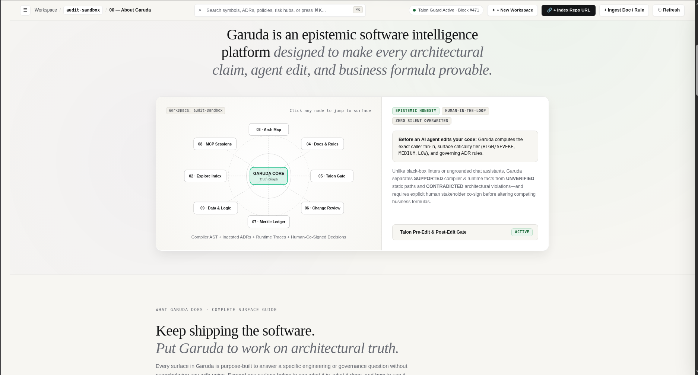
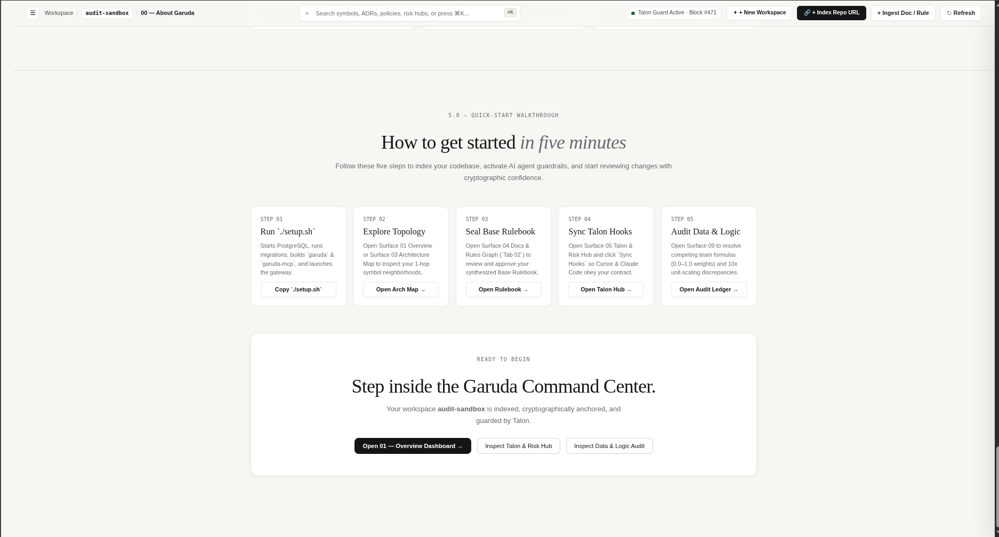
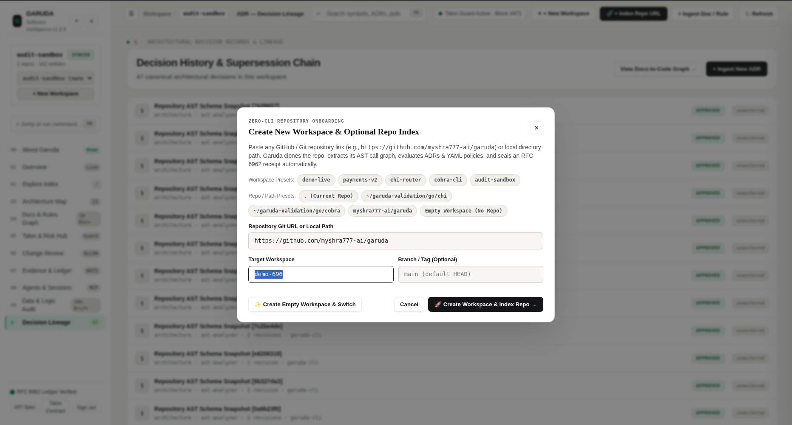
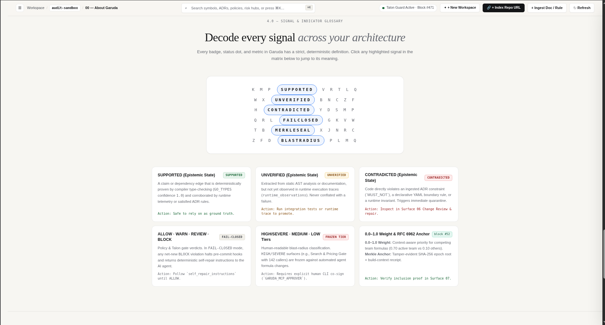
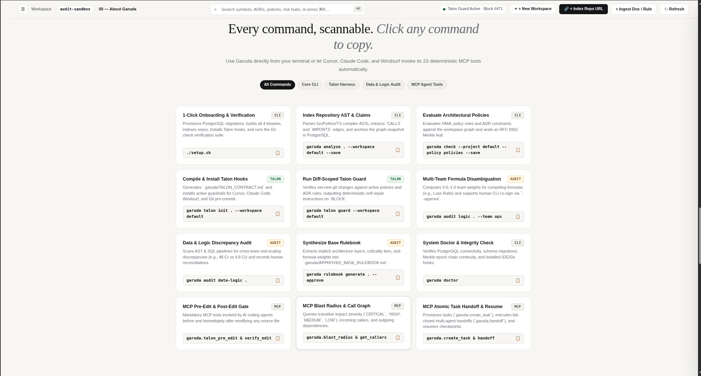

<p align="center">
  
</p>

<h1 align="center">Garuda</h1>

<p align="center">
  <strong>AI can write the code. Garuda makes sure the change respects your system.</strong><br>
  Change control for AI-written code.
</p>

<p align="center">
  <strong>Leading an engineering team?</strong> <a href="docs/WHY_GARUDA.md">The business case in two minutes →</a>
</p>

<p align="center">
  <a href="LICENSE"></a>
  <a href="server.json"></a>
  <a href=".claude-plugin/plugin.json"></a>
  <a href=".codex-plugin/plugin.json"></a>
  <a href="action.yml"></a>
  <a href="https://www.npmjs.com/package/garuda-guard"></a>
</p>

<p align="center">
  
</p>

<p align="center">
  <a href="assets/garuda_dashboard_demo_video.mp4"><strong>▶ Watch the dashboard demo video</strong></a>
</p>

---

## What is this?

You let an AI assistant (Claude Code, Cursor, Codex…) change your code. It works. The tests pass.
But did it quietly skip your service layer, break a rule your team agreed on last year, or change a number your finance team relies on?

Your assistant is good at writing code. It does not automatically know every decision your team made, every part of the system that depends on the code, or every rule that has to stay true.

Garuda is a safety check that sits between your AI assistant and your codebase:

1. **Before** the assistant edits something, Garuda tells it who depends on that code and which rules apply.
2. **After** the edit, Garuda checks the change against your rules and says **allow**, **warn**, **review** or **block**, with plain instructions for fixing it.
3. Saved decisions are sealed into a **tamper-evident log**, so you can prove later what was checked and when.

**Know the impact. Enforce the rules. Keep the evidence.**

Works with Go, Python and TypeScript, and more languages are on the way.

### One change, start to finish

Say your assistant is asked to add a feature to the payment handler.

1. **It asks Garuda first.** Garuda replies: "12 other things depend on this. It is high-risk code. Rule: the payment handler must not talk to the database directly."
2. **The assistant makes its edit.** In a hurry, it calls the database straight from the handler.
3. **Garuda checks the change.** It sees the broken rule, says **BLOCK**, and tells the assistant exactly what to move and where.
4. **The assistant fixes it.** The second check says **ALLOW**.
5. **The result is saved.** You get a receipt you can look up later.

Garuda also separates problems **this change introduced** from problems that were **already there**. You are not asked to clean up years of old code before you can move forward. You only answer for what is new.

It reads Go the way the compiler does, so the answers are repeatable. Python and TypeScript are read by their code structure, which is accurate but not as deep (see [What Garuda does not do](#what-garuda-does-not-do)).

---

## Take the tour (about 10 minutes)

### 1. Install it  ·  *3 minutes*

```bash
git clone https://github.com/myshra777-ai/garuda.git
cd garuda
./setup.sh
```

`setup.sh` starts a local PostgreSQL database, builds the tools into `bin/`, and starts the dashboard.
It prints your login at the end. On Windows use `setup.ps1`.

Just want to look first? `npx garuda-guard demo` runs the demo below with no database (needs Node 18 or newer).
Prefer to let an AI assistant do it? [Copy a prompt for ChatGPT, Claude, Codex or Cursor](docs/INSTALL_WITH_AI.md).

Prefer one line? `curl -fsSL https://raw.githubusercontent.com/myshra777-ai/garuda/main/install.sh | bash` does the same.
(As with any installer you pipe into a shell, [read it first](install.sh).)

### 2. Watch it catch three planted bugs  ·  *1 minute*

```bash
./bin/garuda demo
```

This builds a tiny fake payments service with three problems planted on purpose, runs Garuda's analyzer on it, and lists the problems Garuda is built to catch. It needs no database:

| Planted problem | Why it matters |
| :--- | :--- |
| The payment handler talks to the database directly | Skips the layer that is supposed to guard money movement |
| Money is calculated with `float64`, and one report is off by 10× (`48 Cr` vs `4.8 Cr`) | Silent wrong numbers |
| The storage layer imports the payment layer | Dependencies pointing the wrong way |

You'll see each problem, the exact file and line, and a short "how to fix it" an AI assistant can follow.
The service and its three problems are made up for the demo, and the demo lists them rather than detecting them. To see real detection on real code, finish step 1 and run `garuda check` in step 4. On Windows, run `.\bin\garuda.exe demo`.

### 3. Open the dashboard  ·  *2 minutes*

Go to **http://localhost:8080/login** and sign in with the login `setup.sh` printed.

<p align="center">
  
</p>

The dashboard's front page walks you through five steps. Here is what each part gives you:

**Add your own project.** Click **New Workspace**, paste a GitHub link or a folder path, and Garuda reads the code for you.

<p align="center">
  
</p>

**See your system without the spaghetti.** Instead of one giant tangled graph, Garuda shows the small neighbourhood around the thing you care about: who calls it, and what it calls.

<p align="center">
  
</p>

**Turn written decisions into enforced rules.** Drop in your design docs or decision records (ADRs). Garuda pulls out the "must" and "must not" lines and links them to the code they talk about. No docs yet? It drafts a rulebook from your code for you to approve.

<p align="center">
  
</p>

**Spot numbers that disagree.** When two teams calculate the same metric differently, or one query divides by `1e7` and another by `1e8`, Garuda helps you line up the two versions, shows the formulas it found in the code, and asks a human to decide which one is right. It does not guess.

<p align="center">
  
</p>

**Learn the signals.** Every badge has one fixed meaning:

<p align="center">
  
</p>

| You see | It means |
| :--- | :--- |
| **ALLOW / WARN / REVIEW / BLOCK** | The verdict on a change. BLOCK stops it and tells the assistant how to repair it. |
| **SUPPORTED** | The evidence backs this claim, within what was checked. Safe to rely on. |
| **UNVERIFIED** | Found in the code or docs but not confirmed yet. Not an error. |
| **CONTRADICTED** | The evidence conflicts with a rule or claim you wrote down. |
| **HIGH / MEDIUM / LOW tier** | How many things depend on this code. High-tier code is protected from silent AI rewrites. |

### 4. Point it at your own code  ·  *3 minutes*

```bash
cd /path/to/your/project
/path/to/garuda/bin/garuda init . --wizard      # five short questions
/path/to/garuda/bin/garuda rulebook generate    # drafts rules from your code
/path/to/garuda/bin/garuda check . --diff HEAD  # checks what you just changed
```

Not sure which rules to start with? Pick a ready-made set: `garuda init . --template layered` (also `hexagonal`, `microservices`, `no-circular-imports`, `financial`, `zero-trust-auth`, `ai-agent-safety`, `pii-gdpr-hipaa`, `idempotent-mutations`, or `all`). They live in [`policies/templates/`](policies/templates/).

Coming from ArchUnit, Dependency-Cruiser or Import Linter? `garuda import --from archunit --input <file>` converts your existing rules.

If something looks off, run `./bin/garuda doctor`. It checks your database, migrations and hooks and tells you what is wrong.

<p align="center">
  
</p>

---

## Plug it into your AI assistant

`garuda init` sets this up automatically for Claude Code, Claude Desktop and Cursor. To install it as a plugin instead:

| Tool | How |
| :--- | :--- |
| **Claude Code** | `/plugin marketplace add myshra777-ai/garuda` then `/plugin install garuda@garuda` |
| **OpenAI Codex** | `codex plugin marketplace add myshra777-ai/garuda` |
| **Cursor** | Run `garuda init`; it writes the rules and MCP settings into your project ([`.cursor-plugin/`](.cursor-plugin/plugin.json) has the plugin manifest) |
| **Anything that speaks MCP** | Run `garuda-mcp` over stdio ([example config](.mcp.json)) |

The plugin needs the `garuda-mcp` program and a database, so do step 1 above first.

What your assistant gets: **54 tools** (41 read-only, 13 that can change state) and **6 skills**, short playbooks that tell it when to use them:

| Skill | When the assistant uses it |
| :--- | :--- |
| [`pre-edit-governance`](skills/pre-edit-governance/SKILL.md) | Before changing code: proceed, revise or ask a human? |
| [`change-impact`](skills/change-impact/SKILL.md) | Who calls this, and how far does the damage spread? |
| [`post-edit-verification`](skills/post-edit-verification/SKILL.md) | After the edit: any new violations in this diff? |
| [`violation-repair`](skills/violation-repair/SKILL.md) | A change was blocked; fix it without breaking something else |
| [`architecture-review`](skills/architecture-review/SKILL.md) | Does the real code match the documented design? |
| [`evidence-verification`](skills/evidence-verification/SKILL.md) | Is this claim backed by code, and is the receipt genuine? |

## Check every pull request

Your assistant's good behaviour is a request. A pull request check is a rule. Add the GitHub Action and every pull request gets a verdict:

- the verdict (**ALLOW**, **WARN**, **REVIEW** or **BLOCK**) and a receipt hash in the run summary, with a one-line command to reproduce it on your machine;
- a **BLOCK** fails the check;
- with the ready-made workflow, [`.github/workflows/garuda-gate.yml`](.github/workflows/garuda-gate.yml), you also get a verdict comment on the pull request and findings in GitHub's Security tab;
- optional Slack or Teams alerts through `garuda check --notify-slack` / `--notify-teams`.

Copy a ready-to-paste snippet from [`docs/GITHUB_MARKETPLACE_STRATEGY.md`](docs/GITHUB_MARKETPLACE_STRATEGY.md#33-copy-paste-snippet-for-users), or use [`action.yml`](action.yml) directly.

**One more step makes it real:** in your repository go to **Settings → Rules** (or **Branches**), and make the Garuda check a **required status check**. Until you do, a failing check is only a warning that people can merge past.

---

## What Garuda does not do

We would rather you trust the rest of this page.

- **It is not a cage for your assistant.** Garuda gives the assistant context and blocks bad changes, but an assistant can ignore advice and hooks can be switched off. The check that cannot be skipped is the required pull request check above.
- **Go is understood more deeply than Python and TypeScript.** Go is read with the compiler's own type information. Python and TypeScript are read by code structure, which is accurate for imports, calls and layers but does not resolve every type.
- **Not every check is stored automatically.** A result is only sealed into the tamper-evident log when the check is saved. The log proves a record was not changed afterwards. It does not prove the analysis was complete.
- **The number-mismatch tools help a human decide.** They line up the formulas and values you point them at. They do not automatically understand every financial calculation in a company. `48 Cr` vs `4.8 Cr` in the demo is a planted example.
- **The numbers on this page come from a specific release.** See [`EVIDENCE.md`](EVIDENCE.md) for what was measured, on what, and when.

## Who is it for?

Teams that already use AI coding assistants a lot, on a real codebase with rules that matter: layers that must not be skipped, data-access limits, security or money-handling requirements. If you cannot read every AI-written change yourself, Garuda is for you.

## Free and paid

Everything above runs locally and is free and open source (Apache 2.0). Hosted and multi-team features (shared policies across an organisation, single sign-on, long-term audit storage) are planned for a paid tier.

## Learn more

- [`QUICKSTART.md`](QUICKSTART.md): the same journey with more detail
- [`docs/TALON.md`](docs/TALON.md): how the before-and-after check works
- [`docs/DASHBOARD_WALKTHROUGH.md`](docs/DASHBOARD_WALKTHROUGH.md): every dashboard page
- [`docs/DATA_AND_LOGIC_AUDIT_GUIDE.md`](docs/DATA_AND_LOGIC_AUDIT_GUIDE.md): the number-mismatch checks
- [`docs/adr/`](docs/adr/): the decisions behind Garuda itself
- [`docs/LISTING_GUIDE.md`](docs/LISTING_GUIDE.md): how this project gets listed in plugin and MCP directories
- [`INSTALL.md`](INSTALL.md) · [`docs/API.md`](docs/API.md) · [`EVIDENCE.md`](EVIDENCE.md) · [`SECURITY.md`](SECURITY.md) · [`CONTRIBUTING.md`](CONTRIBUTING.md)

<p align="center">
  <strong>Let AI move fast. Keep control of what it changes.</strong><br>
  Released under the <a href="LICENSE">Apache 2.0 License</a>.
</p>
