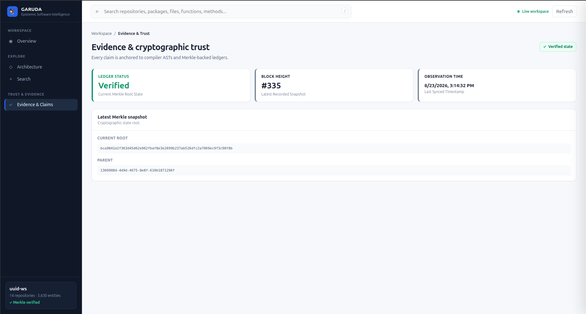

<p align="center">
  
</p>

<h1 align="center">Garuda</h1>

<p align="center">
  <strong>Let agents write code. Keep architecture in the loop.</strong><br>
  Architecture-aware change control and an active execution harness for AI-written software.
</p>

<p align="center">
  <a href="https://github.com/myshra777-ai/garuda/actions/workflows/ci.yml"></a>
  <a href="LICENSE"></a>
</p>

AI coding agents can make a change that compiles, passes tests, and still breaks an architectural rule. A handler may reach directly into a database package. A dependency cycle may appear. A small edit to a widely used symbol may have a much larger impact than the diff suggests.

**Garuda helps teams check those consequences before the change moves forward.** It builds a semantic model of supported code, gives agents architecture-aware context, evaluates changes against explicit rules, and can fail a configured CI gate when a blocking policy is violated.

## The workflow: before the edit, after the edit, before the merge

1. **Before editing — ground the agent.** Garuda Talon can compile workspace ADR claims, YAML policies, and high-impact symbols into an agent-facing contract. `garuda talon brief` and MCP tools provide targeted context and blast radius.
2. **After editing — check what changed.** Talon can incrementally sync dirty files, map diff hunks to indexed symbols, evaluate changed scope, and return repair-oriented feedback.
3. **Before merging — run the gate.** `garuda check --diff ... --fail-on-block` evaluates the selected change against configured policies. A `BLOCK` verdict exits with code `2`; when the CI job is configured as a required check, the failed job can prevent a merge.
4. **Keep the evidence.** With persistence enabled, selected governance evaluations are recorded and can be verified against Garuda's RFC 6962 Merkle ledger.

This is the key distinction: Garuda is not only a graph to inspect. It connects the graph to a change, the change to explicit rules, and the result to a check that teams can run and review.

## Garuda + Talon

Garuda's semantic engine and Talon work together:

| Layer | What it does |
|---|---|
| **Semantic model** | Extracts supported entities and relationships from Go, Python, and TypeScript code. Go uses compiler/type information for supported resolution paths; Python and TypeScript use AST-based analysis with selected cross-file alias and instance-call patterns. |
| **Impact and diff scope** | Maps a Git diff to touched symbols and estimates their graph-visible blast radius. Where diff-scoped evaluation applies, Garuda separates net-new violations from existing baseline findings. |
| **Policy engine** | Evaluates nine supported YAML predicates, including layer violations, dependency cycles, high blast radius, missing verification, and contradictions. |
| **Talon agent harness** | Installs supported editor/Git hooks and generated contracts, provides pre-edit context and post-edit checks, and can supervise a CLI coding agent with bounded self-repair attempts. |
| **Runtime and documentation evidence** | Ingests supported OpenTelemetry spans and extracts supported claims from Markdown/ADRs, then correlates them with the indexed model. |
| **Governance record** | Persists selected outcomes and offers cryptographic integrity/inclusion verification for recorded evidence. |

Talon supports configured integration points—not every possible agent or every possible edit. Review the [Talon guide](docs/TALON.md) for how the hooks work and how to validate their enforcement boundary.

## Try it

Review `setup.sh` before running it. The convenience setup may change local Docker/process state, so do not run it unreviewed on a shared or production machine.

```bash
git clone https://github.com/myshra777-ai/garuda.git
cd garuda
less setup.sh
./setup.sh
```

After initialization, index the repository and ask Talon for context before editing:

```bash
./bin/garuda analyze /path/to/repository --workspace my-app --save

./bin/garuda talon brief PaymentService \
  --workspace my-app --policies ./policies
```

Check the staged change or the diff against `HEAD`:

```bash
./bin/garuda talon guard /path/to/repository \
  --workspace my-app --diff HEAD --fail-on-block
```

For a CI-oriented change-control decision:

```bash
./bin/garuda check \
  --project my-app \
  --diff HEAD \
  --policy ./policies \
  --save \
  --fail-on-block \
  --json
```

A CLI failure is not, by itself, branch protection. Configure the Garuda job as a required repository check in GitHub (or your CI provider), and test the exact revision, database/workspace, policy bundle, permissions, and failure path before relying on it to block merges.

## Give coding agents a source of grounded context

Garuda exposes **23 MCP tools**, plus an architectural-contract prompt and workspace-contract resources. The surface includes symbol discovery, neighbors, implementations, blast radius, policy/evidence queries, contradictions, handoff/resume, and Talon's pre-edit/post-edit calls. The server can inject the active contract into tool responses by default; set `GARUDA_TALON_ENFORCE=false` only when intentionally disabling that behavior.

The dashboard gives people a way to inspect the same workspace model, including architecture neighborhoods, change review, policy outcomes, contradictions, and decision history.



## Validation evidence

The current evidence record reports:

- **24/24** strict compiler/AST benchmark cases passed.
- **30/30** reference MCP/Talon verifier checks passed.
- **10/10** injected contradictions detected in a controlled runtime-verification test.
- A **14-repository Go-only corpus** and a separate **9-repository mixed-language workspace**. The latter snapshot records 14,333 entities and 40,956 relationships.

These are results for named test suites and indexed snapshots—not universal recall, real-production drift detection rates, or proof that every relationship has been discovered. See [EVIDENCE.md](EVIDENCE.md) for scope and reproduction details.

## Evidence, not false certainty

- `SUPPORTED`: available evidence supports a claim within the checked scope.
- `UNVERIFIED`: evidence is insufficient; this does not mean the claim is false.
- `CONTRADICTED`: available evidence conflicts with a claim.

A Merkle proof can verify the integrity and inclusion of a persisted record against a supplied root and proof path. It does not prove the analysis was complete, that a policy was wise, or that the code is bug-free.

## Documentation

| Start here | Purpose |
|---|---|
| [Quick start](docs/QUICKSTART.md) | Get a workspace running and try the first checks |
| [Talon guide](docs/TALON.md) | Contract generation, pre-edit briefing, post-edit guard, hooks and supervisor loop |
| [Capabilities](docs/CAPABILITIES.md) | Implemented surfaces and important boundaries |
| [CLI, MCP and HTTP API](docs/API.md) | Commands, policies, configuration, tools and endpoints |
| [Walkthrough](docs/WALKTHROUGH.md) | End-to-end examples and dashboard tour |
| [Specifications](docs/SPECS.md) | Architecture, data model, contracts and limitations |
| [Evidence and verification](EVIDENCE.md) | Benchmarks, corpora, reproducible checks and methodology |
| [Operational playbook](PLAYBOOK.md) | Installation, operating procedures and troubleshooting |
| [Multi-language coverage](docs/MULTI_LANGUAGE_ROADMAP.md) | Current language support and resolution roadmap |
| [Security policy](SECURITY.md) | Responsible disclosure and security boundaries |

## Current boundaries

- Results depend on successfully indexed files and the relationship types the analyzer supports. Go resolution is stronger than structural Python/TypeScript analysis; none is a complete model of every dynamic behavior.
- Runtime correlation reflects telemetry that was captured, ingested, and mapped.
- Policy outcomes depend on the active rules and evaluation scope. A passing check is not a general correctness guarantee.
- Talon depends on the installed hooks, client behavior, policy configuration, and exit handling. Validate bypass and failure behavior in your environment.
- Garuda is not a code-generating model, a replacement for tests or code review, or a compliance certification.

## Contributing

Contributions and reproducible bug reports are welcome. See [CONTRIBUTING.md](CONTRIBUTING.md). Please keep documentation claims aligned with implementation, tests and measured evidence.

---

Licensed under [Apache 2.0](LICENSE).
