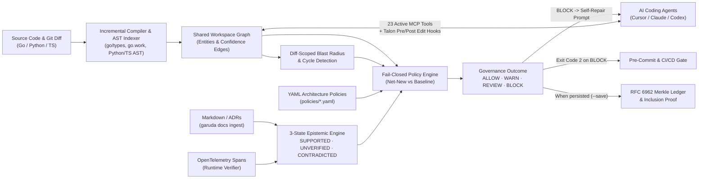

<p align="center">
  
</p>

<h1 align="center">Garuda</h1>

<p align="center">
  <strong>Let agents write. Garuda guards the architecture.</strong><br>
  <em>Garuda watches your architecture even when you aren't watching the diff — it maps, verifies, and gates every change before it merges.</em>
</p>

<p align="center">
  <a href="https://github.com/myshra777-ai/garuda/actions/workflows/ci.yml"></a>
  <a href="https://github.com/myshra777-ai/garuda/actions/workflows/garuda-ci.yml"></a>
  <a href="https://github.com/myshra777-ai/garuda/actions/workflows/garuda-gate.yml"></a>
  <a href="LICENSE"></a>
  <a href="INSTALL.md"></a>
  <a href="PLAYBOOK.md"></a>
  <a href="EVIDENCE.md"></a>
</p>

<p align="center">
  <a href="#the-5-second-workflow">5-Second Workflow</a> ·
  <a href="#garuda-talon-active-agent-harness">Garuda Talon Harness</a> ·
  <a href="#what-garuda-does-for-you">What Garuda Does</a> ·
  <a href="#why-the-graph-is-only-layer-1">The Moat</a> ·
  <a href="#put-the-gate-in-cicd">CI/CD Gates</a> ·
  <a href="#software-intelligence-instrument-dashboard">v1.5 Dashboard</a> ·
  <a href="#23-active-mcp-tools-for-coding-agents">23 Active MCP Tools</a> ·
  <a href="#evidence-not-false-certainty">Epistemic Honesty</a>
</p>

AI coding agents (Cursor, Claude Code, Codex, Devin, Windsurf) write code faster than humans can review it. A pull request can pass every unit test and linter check while quietly introducing a forbidden `Handler -> Database` dependency, creating a circular package dependency (`A -> B -> C -> A`), breaking a shared struct with 170+ downstream callers, or violating documented Architecture Decision Records (ADRs).

**Garuda is a deterministic change-control gate, active AI execution harness (`Garuda Talon`), and architecture intelligence platform for AI-written code.** The moment you initialize Garuda, it compiles your live ADRs and YAML policies into an active contract, hooks directly into your coding agents and Git workflow, forces pre-edit blast-radius checks and post-edit verification, and blocks architectural violations in the editor and in CI before they merge.

## The 5-Second Workflow (Zero Pre-Installed Dependencies)

Whether you are a Product Manager, Founder, or Engineer—**you do not need Go, PostgreSQL, GCC/Xcode, or Docker pre-installed**. Garuda automatically provisions a portable runtime, database, Active MCP, and Garuda Talon in **1 or 2 commands** across **Windows (PowerShell)**, **macOS**, **Linux**, **Chromebook (ChromiumOS)**, and **Android (Termux / PWA)**:

**macOS, Linux, Chromebook (Crostini) & Android (Termux):**
```bash
# Option A: 1-Command Remote Install & Launch
curl -fsSL https://raw.githubusercontent.com/myshra777-ai/garuda/main/install.sh | bash

# Option B: From a cloned repository
git clone https://github.com/myshra777-ai/garuda.git && cd garuda && ./setup.sh
```

**Windows 10 / 11 (PowerShell — Zero Admin / Zero Dependencies):**
```powershell
# Option A: 1-Command Remote Install & Launch (works even without Git, Go, Postgres, or Docker!)
Set-ExecutionPolicy Bypass -Scope Process -Force; irm https://raw.githubusercontent.com/myshra777-ai/garuda/main/install.ps1 | iex

# Option B: From a cloned repository
cd $HOME\garuda
powershell -ExecutionPolicy Bypass -File .\setup.ps1
```

> 📖 **Need platform-specific instructions or hit an installation error?** See the **[Universal Installation & Troubleshooting Guide (`INSTALL.md`)](INSTALL.md)** or run `./bin/garuda doctor --fix` (`.in\garuda.exe doctor --fix` on Windows).

Or run the diff-scoped change-control gate against your uncommitted working tree, staged index, or branch diff:

```bash
# Check only the symbols modified in your current git diff (isolating net-new violations from legacy debt)
./bin/garuda check --diff HEAD --project my-system --policy ./policies --save --fail-on-block

# Or run the active Garuda Talon guard (auto-indexes dirty files + verifies ADRs & policies + emits self-repair instructions)
./bin/garuda talon guard --workspace my-system --fail-on-block
```

**Here is what happens immediately:**

1. **Compiler & AST Extraction (`100%` Local, Sub-Second Incremental Sync)** — Garuda parses your workspace using `go/types` + `go/work` + `vendor/` for Go (`1.0` exact type resolution across modules), Python ASTs (`0.95` cross-file alias and instance call resolution), and Tree-sitter TypeScript ASTs (`0.95` cross-file named/namespace alias and class instance call resolution). With `--incremental` (or automatic `--auto-index` on `garuda check --diff` / `garuda talon guard`), dirty working-tree files are re-indexed in milliseconds.
2. **Git-Diff Native Targeting & Union Blast Radius** — Maps `git diff --unified=0` hunks (`--staged`, `--diff <rev>`, or `--files`) directly to affected AST entities (`[line_start, line_end]`) and computes the union transitive blast radius across all modified symbols.
3. **3-State Epistemic Truth (`SUPPORTED` / `UNVERIFIED` / `CONTRADICTED`)** — Correlates static code edges with ingested Markdown/ADR requirements (`garuda docs ingest`) and live OpenTelemetry runtime spans (`POST /api/v1/telemetry/spans`). Shadow runtime calls or forbidden ADR dependencies are automatically quarantined as `CONTRADICTED`.
4. **Net-New vs. Baseline Policy Evaluation (`ALLOW` / `WARN` / `REVIEW` / `BLOCK`)** — Runs 9 deterministic SQL/CTE policy predicates (`layer_violation`, `transitive_claim_exists`, `cycle_exists`, `blast_radius_exceeds`, `contradiction_exists`, `verification_missing`, `claim_exists`, `entity_exists`, `language_matches`), partitioning violations touching your active diff (`net_new_violations`) from pre-existing legacy debt (`baseline_violations`).
5. **RFC 6962 Merkle Audit Receipt** — When persisted with `--save`, the governance decision and its exact input hashes are anchored in an append-only SHA-256 Merkle tree so any auditor or CI job can cryptographically verify inclusion and tamper-evidence.

## Garuda Talon: Active Agent Harness

Standard MCP servers are **passive** — if an AI coding agent forgets to call a tool, it writes code blind and violates your architecture. **Garuda Talon (`garuda talon` / `bin/garuda-talon`) turns MCP and your local workspace into an active, fail-closed enforcement harness** the moment `./setup.sh` or `garuda init` runs:

| Enforcement Layer | What `garuda talon init` Configures Automatically | How It Forces Agent Compliance |
|---|---|---|
| **1. Active MCP Session Gate (`bin/garuda-mcp`)** | Exposes MCP `prompts/list` (`garuda.architectural_contract`), `resources/list` (`garuda://workspace/contract`, `garuda://workspace/adr-guardrails`), and active session injection (`GARUDA_TALON_ENFORCE=true`). | On the agent's very first MCP tool call, Garuda automatically injects the workspace's active ADR `MUST` / `MUST_NOT` rules and YAML policy guardrails into the response payload so the agent cannot miss them. |
| **2. Cursor Always-On Rule (`.cursor/rules/garuda-talon.mdc`)** | Compiles live ADRs (`document_claims`), YAML policies (`policies/*.yaml`), and top high-blast-radius hubs into `.garuda/TALON_CONTRACT.md` and `.cursor/rules/garuda-talon.mdc` (`alwaysApply: true`). | Forces Cursor agents to call `garuda.talon_pre_edit` before modifying files and `garuda.talon_verify_edit` immediately after editing. |
| **3. Claude Code Active Hooks (`.claude/settings.json` & `CLAUDE.md`)** | Writes `CLAUDE.md` and registers a `PostToolUse` hook on `Edit\|Write\|MultiEdit` in `.claude/settings.json` executing `garuda talon guard --hook`. | Every time Claude Code edits a file, `garuda talon guard --hook` incrementally re-indexes the change and evaluates policies + ADRs. On `BLOCK`, it exits `2` and feeds a structured **Self-Repair Prompt** back to Claude. |
| **4. Codex / Aider / Windsurf (`AGENTS.md` & `.windsurfrules`)** | Maintains idempotent `<!-- GARUDA-TALON:START -->` contract blocks in `AGENTS.md` and `.windsurfrules`. | Ensures CLI and IDE agents share the exact same architectural rules and hub warnings. |
| **5. Git Pre-Commit & Provenance Hooks (`.git/hooks/`)** | Installs `.git/hooks/pre-commit` (`garuda talon guard --staged --fail-on-block`) and `.git/hooks/commit-msg`. | Blocks commits with net-new policy or ADR violations and stamps `Garuda-Governance-Outcome` and `Garuda-Merkle-Block` trailers into every verified commit message. |
| **6. Supervisor Loop (`garuda talon run -- <cmd>`)** | Wraps any autonomous CLI agent (`garuda talon run -- claude ...` or `garuda talon run -- aider ...`). | Intercepts working-tree edits after the agent runs, executes `talon guard`, and automatically loops the agent with the deterministic self-repair prompt (up to `--max-retries 3`) until `ALLOW` is achieved. |

## What Garuda Does for You

| Who You Are | What Garuda Does for You | How You Use It |
|---|---|---|
| **Software Engineers** | Shows every direct and transitive caller, interface implementation, and architectural rule before you refactor a shared struct or service. | Run `garuda talon brief <symbol>`, `garuda check --diff HEAD`, or inspect the **Change Review Workbench** in `/dashboard`. |
| **Staff / Principal Architects** | Turns tribal architecture rules and Markdown ADRs into executable guardrails enforced in the editor, on pre-commit, and on every PR. | Commit policies in `policies/*.yaml`, ingest ADRs with `garuda docs ingest`, and enforce them with `garuda talon guard --fail-on-block`. |
| **AI Coding Agents (Cursor, Claude, Codex)** | Replaces blind grep/RAG guessing with 23 active MCP tools for pre-edit briefing, blast radius, post-edit verification, and self-repair loops. | Call `garuda.talon_pre_edit`, `garuda.blast_radius`, `garuda.talon_verify_edit`, `garuda.handoff`, and `garuda.resume`. |
| **Security & Governance Leads** | Preserves a tamper-evident ledger of every saved architecture decision, policy evaluation, and runtime contradiction with RFC 6962 Merkle inclusion proofs. | Inspect the **Governance & Audit Ledger** surface or call `GET /api/v1/decisions/{id}/verify-evidence`. |

## Why the Graph Is Only Layer 1

Tools like knowledge-graph indexers stop at building a graph to help agents browse files. **In Garuda, the graph is the shared foundation — the product is the active execution harness and deterministic change-control system built on top of it:**



- **Passive Graph Indexers vs. Garuda Talon Active Control:** A passive graph waits for an agent to ask what exists. Garuda Talon injects your ADR and policy rules before the agent writes, intercepts the diff after the agent edits, isolates net-new violations from legacy baseline debt, and forces the agent to self-repair before it can finish.
- **Edge-Level Runtime Contradiction Quarantine:** Static analysis alone misses dynamic dispatch and reflection. Garuda ingests OpenTelemetry trace spans and promotes a static edge to `SUPPORTED` only when **both** caller and callee match at runtime—while automatically creating a `CONTRADICTED` quarantine record whenever production traffic makes an undeclared cross-service or cross-layer call.
- **Fail-Closed Governance by Design:** Malformed policy YAML, unknown predicates, or persistence failures never silently pass (`ALLOW`). Garuda fails closed so broken guardrails cannot wave bad changes through CI.

## Put the Gate in CI/CD

Garuda provides four purpose-built gates so you can enforce the exact failure mode your team requires in local Git hooks or GitHub Actions:

| Gate | Command | What It Enforces | Exit Behavior |
|---|---|---|---|
| **1. Active Talon Diff Gate** | `garuda talon guard --diff origin/main...HEAD --fail-on-block` | Incrementally syncs modified files, resolves touched AST symbols, checks ADR claims + YAML policies (net-new only), and outputs a self-repair plan on failure. | Exits `2` on `BLOCK` (`0` on `ALLOW`/`WARN`/`REVIEW`). |
| **2. Unified Change-Control Gate** | `garuda check --diff HEAD --project <ws> --policy ./policies --save --fail-on-block --json` | Runs all 5 planes across a symbol, file list (`--files`), staged index (`--staged`), or revision range (`--diff`) and seals an RFC 6962 Merkle receipt. | Exits `2` on `BLOCK` (`0` on `ALLOW`/`WARN`/`REVIEW`). |
| **3. Structural Regression Gate** | `garuda ci --baseline ./garuda-baseline.json --block-on-break` | Compares the current branch against a saved baseline snapshot to catch unintended signature breaks, removed exports, or structural regressions. | Exits non-zero when breaking structural changes are detected. |
| **4. Contradiction & Drift Gate** | `garuda ci check --fail-on-contradiction=true` | Verifies that documented architecture claims (`garuda docs ingest`) and runtime traces have zero active `CONTRADICTED` edges in the workspace. | Exits non-zero if any active contradiction exists. |

Start with the included [architecture layer guardrails policy](policies/architecture-layer-guardrails.yaml) and the full [CLI & Policy Reference](docs/API.md).

## Software Intelligence Instrument (`/dashboard`)

Garuda ships a high-craft web instrument at `http://localhost:8080/dashboard` inspired by Linear, Vercel, Sentry, and Neo4j Bloom—replacing noisy full-graph hairballs with 6 focused engineering surfaces and a global `⌘K` / `Ctrl+K` command palette:

1. **Workspace Briefing (`/dashboard#briefing`)** — Clean status strip and health KPIs (Indexed Entities, Policy Posture, Active Contradictions, Merkle Ledger Head) paired with an actionable Needs-Attention queue and recent governance verdicts.
2. **Architecture Map (`/dashboard#map`)** — **Neighborhood-first 1-hop / 2-hop topology explorer** (`[Selected Caller] ──> [Focal Symbol] ──> [Direct Dependency / Policy Badge]`) with interactive hop-depth (`1 hop`, `2 hops`) and edge-kind filters (`Calls`, `Imports`, `Implements`, `Claims`) plus a synchronized 4-tab Inspector Drawer (`Source`, `Relationships`, `Policy Results`, `Evidence`).
3. **Change Review Workbench (`/dashboard#workbench`)** — 3-pane pre-merge simulator: select a target symbol and policy bundle on the left, inspect impacted callers and policy rules in the center, and generate a live `ALLOW` / `WARN` / `REVIEW` / `BLOCK` governance gate receipt on the right.
4. **Policies (`/dashboard#policies`)** — Interactive catalog of all 9 deterministic SQL/CTE policy predicates alongside a live YAML Policy Sandbox to test rules before committing them to CI.
5. **Contradictions & Evidence (`/dashboard#contradictions`)** — Sentry-style forensic queue for `CONTRADICTED` and `UNVERIFIED` claims, comparing static AST location against live OpenTelemetry runtime trace spans (`trace_id`, `span_id`, service pair) plus an interactive OTel Span Simulator.
6. **Governance & Audit Ledger (`/dashboard#ledger`)** — Append-only decision table with a bottom **Decision Record Inspector** (`What it did`, `What it looked at`, `What rule applied`, `Epistemic state`, `RFC 6962 Merkle Inclusion Proof`) and 1-click cryptographic verification.

## 23 Active MCP Tools for Coding Agents

`./setup.sh` automatically registers `garuda-mcp` with **Cursor** and **Claude Desktop** with `GARUDA_TALON_ENFORCE=true` enabled by default. Connected agents receive live MCP Prompts (`garuda.architectural_contract`), MCP Resources (`garuda://workspace/contract`), and 23 deterministic tools:

| Category | MCP Tools | Purpose |
|---|---|---|
| **Active Talon Enforcement** | `garuda.talon_pre_edit`, `garuda.talon_verify_edit` | Mandatory pre-edit blast-radius/ADR briefing and post-edit incremental re-index + diff-scoped policy verification + self-repair generator. |
| **Orientation & Discovery** | `garuda.briefing`, `garuda.entities`, `garuda.find_entity`, `garuda.inspect`, `garuda.query` | Orient the agent to workspace health, resolve exact symbol IDs ranked by inbound edges, and inspect relationships before editing. |
| **Topology & Blast Radius** | `garuda.neighbors`, `garuda.blast_radius`, `garuda.implementers`, `garuda.subclasses`, `garuda.get_impact`, `garuda.get_lineage` | Trace upstream callers, downstream dependencies, interface implementations, class hierarchies, and transitive change impact. |
| **Governance & Policy Gates** | `garuda.policy.list`, `garuda.policy.evaluate`, `garuda.verify_policy_evaluation`, `garuda.governance.status`, `garuda.propose_decision` | Pre-check proposed refactors against active YAML policies and verify RFC 6962 Merkle receipts. |
| **Epistemic Truth & Drift** | `garuda.detect_contradictions`, `garuda.check_drift`, `garuda.query_claims` | Query static-vs-runtime contradictions, ADR `document_claims`, and documentation-to-code drift. |
| **Multi-Agent Continuity** | `garuda.handoff`, `garuda.resume` | Atomically transfer task ownership and restore serialized checkpoints across multi-agent sessions. |

### Complete CLI Command Surface

- `garuda init <repo-path> --workspace <name>` — Initialize Postgres, migrations, owner account, Active MCP, and Garuda Talon hooks in 1 command.
- `garuda doctor [--fix] [--json]` — Diagnose and auto-repair `.env`, PostgreSQL, binaries, MCP config, and Talon hooks across Windows, macOS, Linux, Chromebook, and Android.
- `garuda talon <init|contract|brief|guard|run>` (or `garuda-talon ...`) — Manage the active AI execution harness, inspect compiled ADR/policy contracts, gate working-tree diffs, or supervise agent commands.
- `garuda analyze <path> [--incremental] [--files a.go,b.go] [--save]` — Run full or incremental compiler-backed Go (`go/types` + `go.work`), Python, and TypeScript AST extraction.
- `garuda check [--diff <rev> | --staged | --files <csv> | --target <sym>] [--net-new-only] [--save] [--fail-on-block]` — Turn a symbol or git diff into an evidence-backed governance decision.
- `garuda impact --target <symbol>` — Compute confidence-weighted transitive blast radius from the terminal.
- `garuda policy evaluate --policy <dir>` — Evaluate YAML architecture policies across the active workspace.
- `garuda docs <ingest|verify|status>` — Extract architectural claims from Markdown/ADRs and verify them against code.
- `garuda hygiene` (alias `garuda ponytail`) — Detect structural dead-ends, orphaned symbols, and architectural drift.
- `garuda topology` & `garuda summary` — Inspect package-level layering, hub centrality, and workspace metrics.

## Evidence, Not False Certainty

Garuda keeps the boundaries of its evidence explicit so teams never mistake a clean check for magical omniscience:

- **`SUPPORTED`** — Available static and/or runtime evidence corroborates the claim within the verified scope.
- **`UNVERIFIED`** — Static structure exists, but runtime or secondary corroborating evidence has not yet been observed. It does *not* mean the relationship is broken.
- **`CONTRADICTED`** — Available evidence actively conflicts with a claim (for example, an ADR states `CheckoutHandler` must not call `OrderRepository`, or an OpenTelemetry span observes an undeclared runtime call).

**What the RFC 6962 Merkle Ledger Proves (and What It Doesn't):**
The Merkle ledger cryptographically proves the **inclusion, ordering, and tamper-evidence of persisted governance records** (`--save`). It does **not** prove that an unindexed dynamic call cannot exist, that a human-written YAML policy is wise, or that the software is bug-free. Preview evaluations run without `--save` are ephemeral and are not anchored to the ledger.

## Supported Languages & Verification Benchmarks

| Language | Analysis Engine | Confidence & Scope | Status |
|---|---|---|---|
| **Go** | `go/types`, `go/ssa`, `go.work`, `vendor/` | Exact compiler-grade type, interface, and cross-module call resolution (`1.0` static confidence). | **Production** |
| **Python** | Structural + Alias/Receiver AST Analyzer | Module, class, function, `import X as Y` / `from X import Y as Z` alias, and instance method call-graph resolution (`0.95` static confidence). | **Production-Ready** |
| **TypeScript** | Tree-sitter + Alias/Instance AST Analyzer | Interface, class, function, named/namespace import alias, `new Class()` instance, and cross-file call-graph resolution (`0.95` static confidence). | **Production-Ready** |

- **Reproducible Verification Suite:** `make benchmark-strict` executes 24 ground-truth compiler and cross-module benchmarks (`TestDoubleRunDeterminism` across all 24 cases), `30/30` reference MCP & Talon active verifier checks (`scripts/mcp_verify.py`), and `10/10` edge-level runtime contradiction detections (`scripts/runtime_contradiction_test.py`). See [EVIDENCE.md](EVIDENCE.md) for full methodology and scope boundaries.

## Documentation

- **[Universal Installation & Troubleshooting Guide](INSTALL.md)** — 1-command zero-dependency setup for Windows PowerShell, macOS, Linux, Chromebook (ChromiumOS), and Android (Termux & Chromium PWA), plus the 12-item installation error troubleshooting table.
- **[Operational Playbook](PLAYBOOK.md)** — 1-command onboarding, Garuda Talon harness setup, MCP client wiring (Cursor, Claude Code, Codex), policy authoring, runtime OpenTelemetry ingestion, and troubleshooting.
- **[System Walkthrough](docs/WALKTHROUGH.md)** — End-to-end CLI, v1.5 Dashboard, Garuda Talon, MCP, and VS Code extension workflows.
- **[Capabilities & Verification Tiers](docs/CAPABILITIES.md)** — Detailed breakdown of capabilities and verification guarantees.
- **[CLI, Policy, MCP & HTTP API Reference](docs/API.md)** — Complete reference for all CLI flags, 9 policy predicates, 23 MCP tools, and REST endpoints.
- **[System Specifications](docs/SPECS.md)** — Architecture internals, PostgreSQL schema, Ed25519 JWT auth, and Merkle tree specifications.
- **[Verification Evidence](EVIDENCE.md)** — Reproducible benchmark output, test coverage, and explicit security/epistemic boundaries.
- **[Changelog](CHANGELOG.md)** · **[Codebase Hygiene](docs/hygiene.md)** · **[License (Apache 2.0)](LICENSE)**
