<p align="center">
  
</p>

<h1 align="center">Garuda (<code>v1.9.9</code>)</h1>

<p align="center">
  <strong>AI writes code at 100 mph. Garuda makes sure your architecture, business formulas, and cross-team numbers survive the ride.</strong><br>
  <em>The local-first change-control gate, active AI agent harness (<code>Garuda Talon</code>), human-in-the-loop Data &amp; Logic Audit engine, <strong>54-tool MCP server</strong>, and <strong>10-surface progressive-disclosure Software Intelligence Dashboard</strong>.</em>
</p>

<p align="center">
  <a href="https://github.com/myshra777-ai/garuda/actions/workflows/ci.yml"></a>
  <a href="https://github.com/myshra777-ai/garuda/actions/workflows/garuda-ci.yml"></a>
  <a href="https://github.com/myshra777-ai/garuda/actions/workflows/release-packages.yml"></a>
  <a href="capabilities.json"></a>
  <a href="LICENSE"></a>
  <a href="EVIDENCE.md"></a>
</p>

<p align="center">
  <a href="#what-is-garuda-in-plain-english">What Is Garuda?</a> ·
  <a href="#install-in-one-command-zero-dependencies">1-Command Install</a> ·
  <a href="#canonical-capability--verification-manifest-p3">Canonical Manifest &amp; 3-Tier Evidence</a> ·
  <a href="#tour-the-futuristic-10-surface-dashboard-dashboard-pwa">Visual Dashboard Tour</a> ·
  <a href="#everyday-cli--mcp-workflows">CLI &amp; 54-Tool MCP Guide</a> ·
  <a href="#github-packages--github-marketplace-integration">GitHub Marketplace &amp; Packages</a> ·
  <a href="#documentation-suite-by-role">Documentation Suite</a>
</p>

---

## What Is Garuda? (In Plain English)

AI coding agents (**Cursor**, **Claude Code**, **Codex**, **Windsurf**) can generate a thousand lines of code in thirty seconds. The code compiles and unit tests pass—yet four critical classes of drift silently slip into production:

1. **Silent Layer & Boundary Shortcuts**: An AI agent makes an API handler query `database/sql` or an external payment client directly, bypassing retry, idempotency, or store layers.
2. **Competing Undocumented Business Formulas Across Teams**: **Ops**, **Marketing**, and **Management** each implement their own formula for the same concept (such as *Loss Ratio* or *Retention*). Without a referee, an agent copies a campaign formula into a core settlement router with 142 callers.
3. **10x Cross-Team Unit-Scaling Mismatches (`48.00 Crore` vs. `4.80 Crore`)**: One team's pipeline divides raw Rupees by `10,000,000` (`48.00 Crore`), while another divides Lakhs by `1,000` instead of `100` (`4.80 Crore`).
4. **Undocumented Tribal Architecture**: Most repositories lack up-to-date ADRs, leaving engineers and AI agents blind to which surfaces are mission-critical (`HIGH_SEVERE`) and which are safe to refactor (`LOW`).

**Garuda (`v1.9.9`) is your local-first architectural safety net and truth engine.** It indexes Go, Python, and TypeScript ASTs into a single PostgreSQL + RFC 6962 Merkle graph, enforces pre-edit and post-edit guardrails via **Garuda Talon** and **`54` deterministic MCP tools**, and provides a calm, progressive-disclosure **`10`-Surface Web Dashboard**.

---

## Install in One Command (Zero Dependencies)

You do **not** need Go, PostgreSQL, Docker, GCC, Homebrew, or Xcode pre-installed, and you do **not** need `sudo` or Administrator rights:

```bash
# Linux, macOS (Apple Silicon & Intel), Chromebook (Crostini) & Android (Termux)
curl -fsSL https://raw.githubusercontent.com/myshra777-ai/garuda/main/install.sh | bash

# Or inside an existing cloned repository
./setup.sh
```

```powershell
# Windows 10 / 11 (PowerShell 5.1 & PowerShell 7 — No Admin Required)
Set-ExecutionPolicy Bypass -Scope Process -Force; irm https://raw.githubusercontent.com/myshra777-ai/garuda/main/install.ps1 | iex
```

---

## Canonical Capability & Verification Manifest (`P3`)

All counts, versions, and tool definitions across Garuda's binaries and documentation are synchronized from **[`capabilities.json`](capabilities.json)** and **[`internal/version/manifest.go`](internal/version/manifest.go)** (verified in CI via `python3 scripts/sync_docs_from_manifest.py --check`):

| Canonical Dimension | Count / Value | Source of Truth |
| :--- | :--- | :--- |
| **Canonical Release Version** | **`v1.9.9`** (`2026-11-01`) | `capabilities.json` · `internal/version/manifest.go` · `version.txt` |
| **Core Zero-CGO Binaries** | **`4`** (`garuda`, `garuda-mcp`, `garuda-api`, `garuda-talon`) | `cmd/*` (`CGO_ENABLED=0`) |
| **Registered MCP Tools (`bin/garuda-mcp`)** | **`54`** (`41` read-only · `13` mutating) | `cmd/garuda-mcp/main.go` · `tools_whitelist.go` |
| **MCP Positive & Negative Behavioral Tests** | **`54/54` tools** (`108` positive + negative subtests) | `cmd/garuda-mcp/behavioral_tools_test.go` |
| **Live MCP Protocol Verification Suite** | **`63/63` checks** | `scripts/mcp_verify.py` |
| **Dashboard Working Surfaces (`/dashboard`)** | **`10` surfaces** (`≤ 4` primary cards on first view) | `internal/api/templates/dashboard.html` |
| **Dashboard HTTP API Endpoints** | **`19` endpoints** | `internal/api/static/dashboard.js` |
| **Idempotent PostgreSQL Migrations** | **`95`** (`001`–`095_data_logic_audit_ledger_and_hygiene.sql`) | `migrations/` |
| **Graph-Native YAML Policy Predicates** | **`9` predicates** | `internal/policy/` |


### The Four-Tier Document-to-Code Governance Graph (`garuda.docs_graph` & Surface `04`)

Garuda connects four layers of an engineering organization into one inspectable document-to-code governance graph:

| Governance Tier | Layer | What It Connects |
| :--- | :--- | :--- |
| **Tier 1 — Organizational Intent** | ADRs, Specs, Invariants & YAML Policies | `docs/adr/*.md`, `docs/specs/*.md`, `policies/*.yaml`, `.garudarules` |
| **Tier 2 — Extracted Normative Rules** | `MUST`, `MUST_NOT`, `BLOCK`, `REVIEW`, `DENY` | Collision-free SHA-256 component nodes extracted from documents |
| **Tier 3 — Executable Governance** | Active YAML Policies & Talon Guardrails | Compiled `.garuda/TALON_CONTRACT.md` & deterministic policy verdicts |
| **Tier 4 — Actual Software (AST)** | Indexed Functions, Methods & Packages | Go (`go/types`), Python AST, and TypeScript AST entities & call edges |

> **Link Provenance Transparency**: Every document-to-code link returned by `garuda.docs_graph` and `/api/v1/dashboard/docs-graph` carries an explicit `match_method` (`"ast_exact"`, `"package_or_keyword_match"`, or `"fallback_unindexed_preview"`) and `graph_source_mode` (`"live_indexed_ast"` vs. `"fallback_preview_unindexed"`), distinguishing compiler-resolved AST links from keyword/package rules and unindexed workspace previews.

### Multi-Agent Coordination & Operational Continuity Layer

Garuda understands the work of agents, not just their code—preserving shared operational context as tasks move across concurrent AI coding agents:

| Capability | Implementation Surface | What It Enables |
| :--- | :--- | :--- |
| **MCP Session Tracking** | `cmd/garuda-mcp/session_tracking.go` | Identifies connected MCP clients/agents, active activity, and session duration. |
| **Tool Execution Telemetry** | `cmd/garuda-mcp/telemetry.go` | Records tool names, execution latency, success/error counts, and whitelist-filtered arguments (`filterArgs`). |
| **Agent-Specific Briefings** | `garuda.briefing` / `garuda.preflight_bundle` | Tracks when an agent was last briefed and reports workspace deltas since that watermark. |
| **Task Checkpoints** | `garuda.create_task` / `checkpoints` | Persists structured execution context and scope metadata for a task UUID. |
| **Serializable Atomic Handoffs** | `garuda.handoff` (`internal/store/handoff_store.go`) | Locks and validates agents and task ownership inside a serializable transaction, saves a checkpoint, transfers ownership, and fails closed on unknown task UUIDs. |
| **Checkpoint Resume** | `garuda.resume` | Restores saved checkpoint state for the receiving agent and marks the checkpoint consumed. |
| **Decision Lineage** | `garuda.propose_decision` & Surface `§` | Makes MADR architectural and formula decisions and their supersession chain inspectable. |

### Strict Separation of Evaluation Tiers (Fixtures vs. Simulations vs. Live AST/LLM)

Garuda strictly separates **compiler benchmark fixtures**, **synthetic fault-injection simulations**, and **live production repository / LLM agent results** so benchmark or demo data never pollutes live workspace queries:

| Evaluation Tier | Scope & Activation Flag | Default in Production Workspaces | What It Measures & Verifies |
| :--- | :--- | :--- | :--- |
| **Tier 1 — Compiler Fixture Results** (`24/24`) | `make benchmark-strict` or `include_fixtures=true` | **EXCLUDED BY DEFAULT** (`ExcludeFixturesSQL` filters out `test/fixtures/`, `testdata/`, `garuda-bench/`, `conftest`) | Static `go/types`, `go.work`, Python AST, and TypeScript AST extraction precision/recall (`100%`) and checkout-path-invariant cache fingerprints (`TestDoubleRunDeterminism`). |
| **Tier 2 — Synthetic Grounding & Contradiction Simulations** (`10/10`) | `scripts/runtime_contradiction_test.py`, `--demo-fixtures`, `simulate_violation`, `simulate_drift` | **OPT-IN ONLY** (Empty workspaces return `status: "INSUFFICIENT_DATA"` when `include_fixtures=false`) | Quarantine of injected unapproved OTel runtime spans (`10/10`), Talon self-repair prompt synthesis under simulated `BLOCK`/drift, and reference case studies (`Loss Ratio` `0.0–1.0` weights & `48.00 Cr vs 4.80 Cr`). |
| **Tier 3 — Live AST, RFC 6962 Ledger & Live LLM/MCP Sessions** (`63/63` & `54/54`) | Default live mode (`scope: "production_only"`, `GARUDA_TALON_ENFORCE=true`) | **ACTIVE BY DEFAULT** | Live repository symbol & blast-radius resolution, cryptographic tenant/workspace isolation, `GARUDA_MCP_READ_ONLY=true` mutation blocking, `GARUDA_MCP_APPROVER` human co-sign verification, and SHA-256 `receipt_hash` validation. |

---

## Tour the Futuristic 10-Surface Dashboard (`/dashboard` PWA)

Garuda's web interface runs 100% locally at `http://localhost:8080/dashboard` with progressive disclosure (**at most 4 cards on first view**), smooth `cubic-bezier(0.16, 1, 0.3, 1)` animations, and a 1-click toggle between **Warm Alabaster Light Mode** and **Obsidian Graphite Dark Mode** (`☀ / ☾`):

### `01` — Overview: Calm Command Center (`4` Primary Cards + `2` Expandable Drawers)
Displays **1 Hero System Integrity Card** (`ALLOW` / `BLOCK`) + **3 clickable core metric cards** (*Indexed Topology*, *Epistemic & Policy Gate*, *RFC 6962 Provenance Ledger*), with collapsible `<details>` drawers for *Needs Attention & Documentation Drift* and *Architectural Hubs & Indexed Repositories*.

<p align="center">
  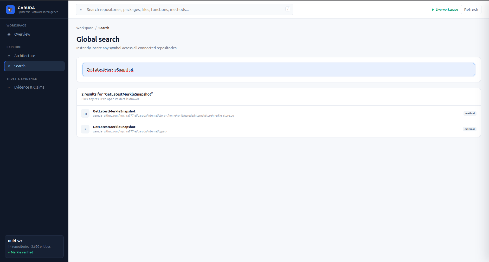
</p>

### `02` — Explore Index: Instant Semantic Symbol Search (`⌘K`)
Search repositories, packages, functions, methods, structs, and interfaces with instant signature preview and 1-hop neighborhood actions.

<p align="center">
  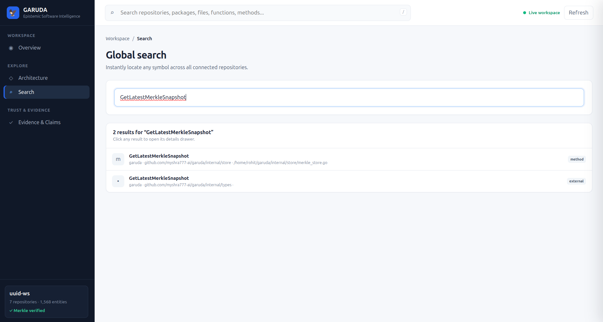
</p>

### `03` — Architecture Map: Full-Viewport Neighborhood & AST Graph
Explores 1-hop and 2-hop symbol neighborhoods (`Callers → Symbol → Dependencies`) on an interactive D3 canvas (`74vh+`) with a collapsible depth/edge filter bar and synchronized entity inspector.

<p align="center">
  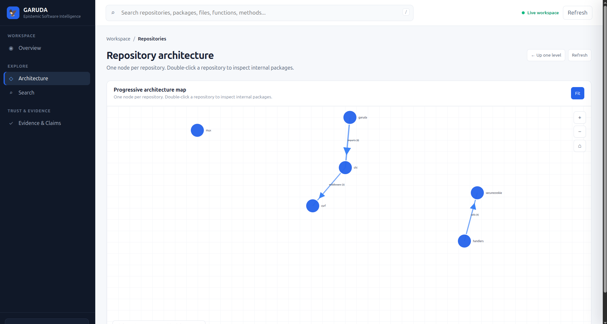
</p>

### `04` — Docs & Rules Graph: 4-Tab Progressive Lineage & Base Rulebook Studio
Switches cleanly between **01 · Interactive 4-Tier Graph** (`Document → Rule → Policy → Code`), **02 · Base Rulebook Studio** (`.garuda/APPROVED_BASE_RULEBOOK.md`), **03 · Ingested Documents**, and **04 · Extracted Rules Matrix**.

<p align="center">
  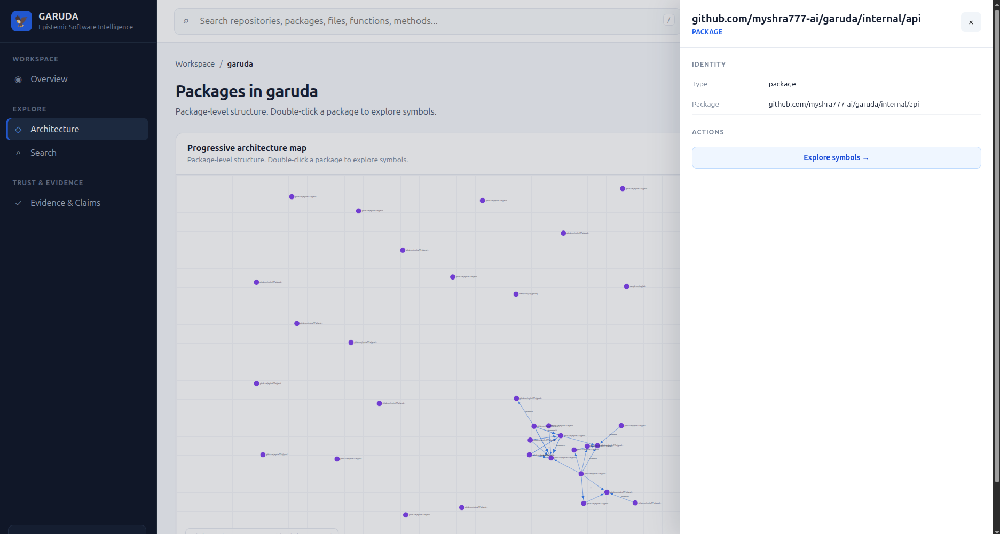
</p>

### `05` — Talon & Risk Hub: Active AI Agent Guardrails (`3` Sub-Tabs)
Organizes AI agent governance into **01 · Live Enforcement Gate & Hooks** (6 IDE/Git hooks + self-repair simulator), **02 · Risk Hub Leaderboard & Surface Criticality**, and **03 · Deterministic Build Matrix & Receipt**.

<p align="center">
  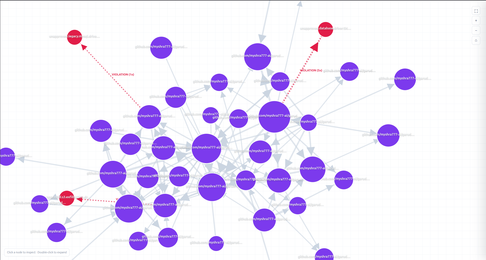
</p>

### `06` — Change Review Workbench (`3`-Pane Pre-Merge Simulator)
Inspect any symbol or git diff across three balanced cards: **01 · Change Context**, **02 · Blast-Radius Impact Map**, and **03 · 3-Plane Verification & Decision Record**.

<p align="center">
  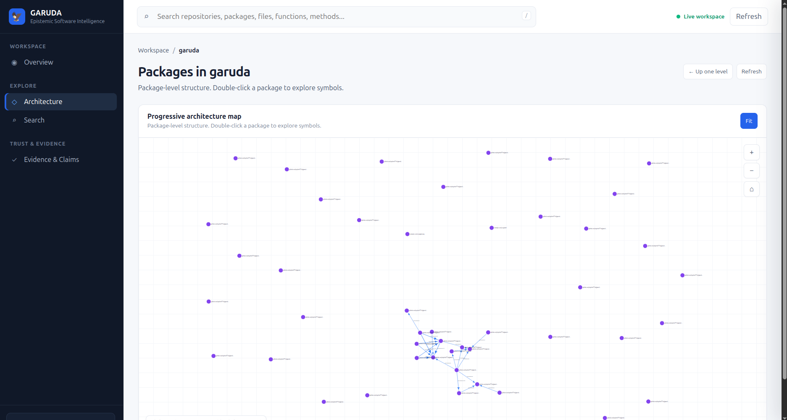
</p>

### `07` — Evidence & Ledger, `08` — Agents, `09` — Data & Logic Audit, `§` — Decision Lineage
- **`07 — Evidence & Ledger`**: Consolidated RFC 6962 Merkle epoch header + append-only audit table with an expandable Decision Record & Raw Telemetry drawer.
- **`08 — Agents & Sessions`**: Active MCP client sessions and multi-agent task handoff timeline.
- **`09 — Data & Logic Audit`**: Tabbed **Pillar 1 · Multi-Team Formula Weights (`0.0–1.0`)** and **Pillar 2 · Cross-Team Data & Logic Discrepancies (`48.00 Cr vs 4.80 Cr`)** backed by `data_logic_audit_ledger`.
- **`§ — Decision Lineage`**: MADR-compatible Architectural Decision Records and supersession chains.

<p align="center">
  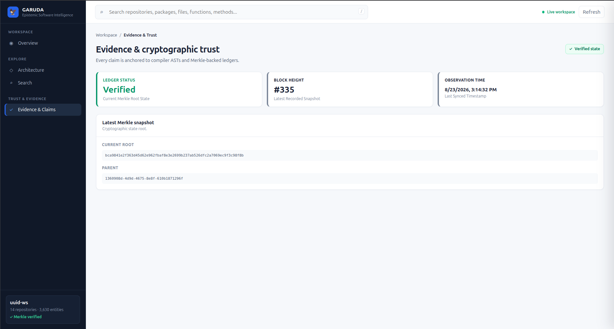
</p>

<p align="center">
  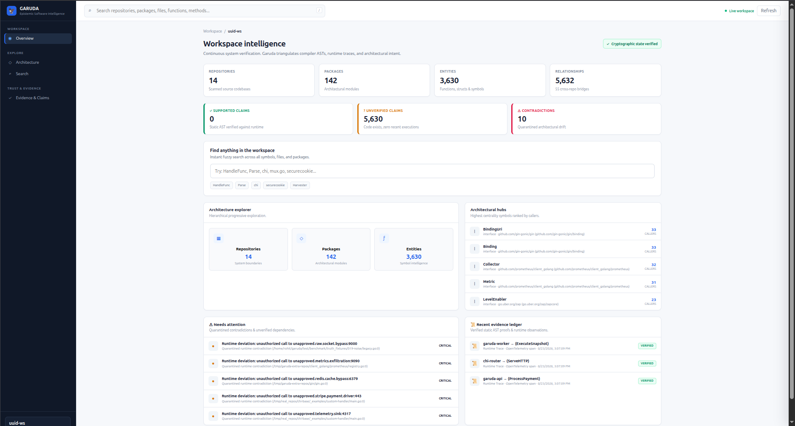
</p>

### VS Code & Cursor IDE Extension (`vscode-extension/`)

| IDE Graph View (`assets/screenshots/ide-graph-view.png`) | IDE Contradictions Panel (`assets/screenshots/ide-contradictions.png`) |
| :---: | :---: |
| 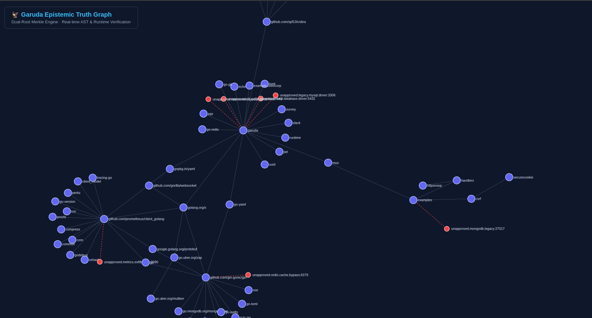 | 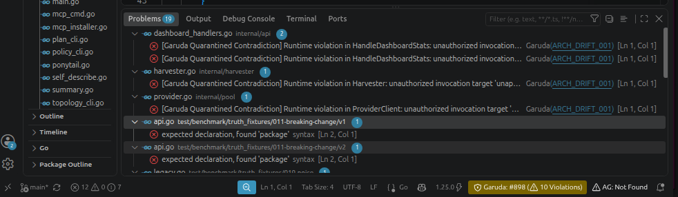 |

### Additional Workspace, AST & Multi-Repository Views (`assets/`)

| View & Asset Path | Preview |
| :--- | :--- |
| **Top Level Repo Graph** (`assets/screenshots/top-level-repo-graph.png`) | 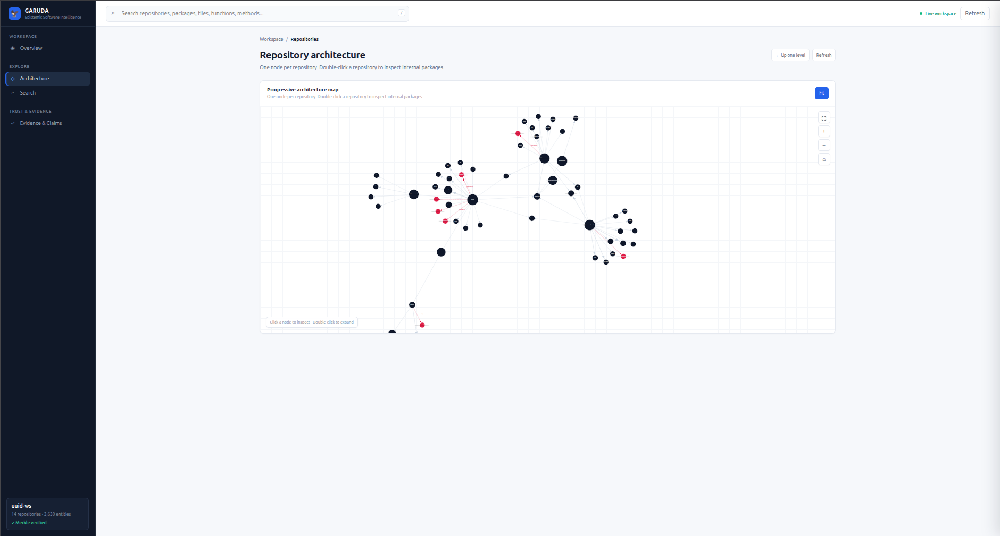 |

---

## Everyday CLI & MCP Workflows (`54` Registered Tools)

| Workflow | CLI Command (`garuda ...`) | MCP Tool (`garuda-mcp`) |
| :--- | :--- | :--- |
| **1-Call Pre-Edit Context & Blast Radius** | `garuda talon brief <Symbol>` | `garuda.preflight_bundle` / `garuda.talon_pre_edit` |
| **Post-Edit Diff Check & Self-Repair Prompt** | `garuda talon guard --diff HEAD --fail-on-block` | `garuda.talon_verify_edit` |
| **Verify Deterministic Build & Graph Receipt** | `garuda check --workspace default` | `garuda.verify_receipt` / `garuda.snapshot` |
| **Diff Workspace Snapshots & Symbol Impact** | `garuda analyze --diff before.json after.json` | `garuda.diff_snapshots` / `garuda.diff_impact` |
| **Verify Cross-OS Build Matrix (`4` Profiles)** | `garuda check --matrix --workspace default` | `garuda.build_matrix_check` |
| **Compare Competing Team Formulas (`0.0–1.0`)** | `garuda audit logic "Loss Ratio" --team ops` | `garuda.disambiguate_logic` / `garuda.decide_logic_variant` |
| **Audit Cross-Team Data & Unit-Scaling (`48 Cr` vs `4.8 Cr`)** | `garuda audit data-logic --metric "Claims Paid"` | `garuda.audit_data_discrepancy` / `garuda.reconcile_data_audit` |
| **Inspect 3-Tier Surface Criticality** | `garuda audit criticality` | `garuda.criticality_tiers` |
| **Auto-Generate & Seal Base Rulebook** | `garuda rulebook generate && garuda rulebook approve` | `garuda.synthesize_rulebook` / `garuda.approve_base_rulebook` |
| **Anti-Hallucination Claim & Coverage Check** | `garuda docs verify` | `garuda.verify_claim` / `garuda.explain_claim` / `garuda.symbol_test_coverage` |
| **Provision Isolated Sandbox & Export Audit Trail** | `garuda init --workspace audit-sandbox` | `garuda.create_workspace` / `garuda.audit_export` |

---

## Five Core Governance Capabilities & End-to-End Scenario

> **AI can write the code. Who governs the change?**
> An AI agent modifies a payment service. Garuda discovers that the change bypasses the service layer, violates an architectural decision (`ADR-0001`), and introduces a financial unit-scaling precision risk (`48.00 Cr` vs `4.80 Cr`). **Garuda Talon** evaluates the change, identifies the violations, provides an actionable self-repair direction, and prevents the unacceptable change from passing the configured gate. The resulting governance decision is anchored with verifiable RFC 6962 Merkle evidence.
> **Understand the system. Govern the change. Preserve the proof.**

| Pillar | What It Establishes |
| :--- | :--- |
| **1. Software Intelligence** | Understands code structure, dependencies, relationships, and blast-radius impact across Go (`go/types`), Python, and TypeScript. |
| **2. Architecture Intelligence** | Discovers, synthesizes, and maintains architectural rules, auto-generated Base Rulebooks (`.garuda/APPROVED_BASE_RULEBOOK.md`), and ADRs. |
| **3. Business Logic Governance** | Evaluates competing team formulas (`0.0–1.0` weights), data relationships, and unit-scaling discrepancies (`48.00 Cr` vs `4.80 Cr`). |
| **4. Agent Change Control** | Guides agents (`garuda.talon_pre_edit`), evaluates modifications (`garuda.talon_verify_edit`), and enforces fail-closed policies. |
| **5. Verifiable Governance** | Records human-in-the-loop decisions and provides cryptographic RFC 6962 SHA-256 Merkle inclusion proofs. |

---

## 🔌 MCP Server & AI Coding Agent Integrations

Garuda ships a hardened `54`-tool MCP server (`garuda-mcp`) and native plugin manifests:

- **Claude Code & Claude Desktop**: Auto-configured by `garuda init` (`.claude/settings.json` + [`CLAUDE.md`](CLAUDE.md) + [`.claude-plugin/plugin.json`](.claude-plugin/plugin.json)).
- **Cursor IDE**: Auto-configured by `garuda init` (`.cursor/rules/garuda-talon.mdc` + `.cursor/mcp.json` + [`.cursor-plugin/plugin.json`](.cursor-plugin/plugin.json)).
- **OpenAI Codex Plugin**: Native manifest at [`.codex-plugin/plugin.json`](.codex-plugin/plugin.json) and [`AGENTS.md`](AGENTS.md).
- **MCP Registries**: Ready-to-publish manifests for Official MCP Registry ([`mcp-registry.json`](mcp-registry.json)), Smithery ([`smithery.yaml`](smithery.yaml)), and Glama ([`glama.json`](glama.json)).

## 📚 Architecture Decision Records (ADRs), Playbooks & Deep Dives

- **Quickstart & Monorepo Guide**: [`QUICKSTART.md`](QUICKSTART.md)
- **Technical Deep-Dive Blog Post**: [`docs/BLOG_AST_MERKLE_AGENT_GOVERNANCE.md`](docs/BLOG_AST_MERKLE_AGENT_GOVERNANCE.md)
- **Architectural Decision Records ([`docs/adr/`](docs/adr/))**:
  - [`ADR-0001: Payment Idempotency & Hexagonal Store Isolation`](docs/adr/0001-payment-idempotency.md)
  - [`ADR-0002: RFC 6962 Canonical SHA-256 Merkle Provenance Layer`](docs/adr/0002-rfc6962-merkle-ledger.md)
  - [`ADR-0003: Three-State Epistemic Honesty (SUPPORTED, UNVERIFIED, CONTRADICTED)`](docs/adr/0003-epistemic-honesty.md)
- **Operational Playbooks ([`docs/playbooks/`](docs/playbooks/README.md))**: [`docs/playbooks/README.md`](docs/playbooks/README.md)
- **Database Schema & Migrations ([`migrations/`](migrations/))**: [`migrations/`](migrations/) (including [`095_data_logic_audit_ledger_and_hygiene.sql`](migrations/095_data_logic_audit_ledger_and_hygiene.sql), [`096_policy_evaluations_decision_check.sql`](migrations/096_policy_evaluations_decision_check.sql), [`097_multi_tenant_rbac_isolation.sql`](migrations/097_multi_tenant_rbac_isolation.sql), and [`098_strict_workspace_and_tenant_isolation.sql`](migrations/098_strict_workspace_and_tenant_isolation.sql))
- **10/10 Multi-Tenant Isolation & Evidence Regression Suite**: [`internal/api/tenant_isolation_test.go`](internal/api/tenant_isolation_test.go) (`go test -v ./internal/api -run "Test0|Test10"`)

---

## GitHub Packages & GitHub Marketplace Integration

Garuda `v1.9.9` ships with first-class support for **GitHub Packages (`ghcr.io`)** and the **GitHub Marketplace (`action.yml`)**. See **[`docs/GITHUB_MARKETPLACE_STRATEGY.md`](docs/GITHUB_MARKETPLACE_STRATEGY.md)** for the full launch playbook:

```yaml
# Use Garuda Talon directly from GitHub Marketplace in any workflow:
- name: Garuda Talon Architecture & Data-Logic Gate
  uses: myshra777-ai/garuda@v1.9.9
  with:
    workspace: default
    policy-dir: policies
    fail-on-block: "true"
    matrix: "true"
```

```bash
# Pull the multi-arch OCI container from GitHub Packages (GHCR):
docker pull ghcr.io/myshra777-ai/garuda:v1.9.9
```

---

## Documentation Suite by Role

| Document | Audience | Description |
| :--- | :--- | :--- |
| **[`capabilities.json`](capabilities.json)** | **All Tools & Evaluators** | Single canonical version & capability manifest (`v1.9.9`, `54` MCP tools, `10` surfaces, `95` migrations). |
| **[`docs/PERSONA_ONBOARDING_GUIDE.md`](docs/PERSONA_ONBOARDING_GUIDE.md)** | **All Users (Start Here!)** | 5-minute onboarding paths for Engineers, Architects, Data/Audit Leads, PMs, DevOps, and AI Agents. |
| **[`INSTALL.md`](INSTALL.md)** | **Everyone** | 1-command zero-dependency setup across Linux, macOS, Windows PowerShell, Chromebook, and Android. |
| **[`docs/WALKTHROUGH.md`](docs/WALKTHROUGH.md)** | **Product & Engineering Teams** | Visual walkthrough of the redesigned `10`-surface progressive-disclosure `/dashboard` PWA. |
| **[`docs/DATA_AND_LOGIC_AUDIT_GUIDE.md`](docs/DATA_AND_LOGIC_AUDIT_GUIDE.md)** | **Engineering & Data Leads** | `0.0–1.0` formula weighting, active contradiction quarantine, and `data_logic_audit_ledger`. |
| **[`docs/API.md`](docs/API.md)** | **Tooling & Integration Engineers** | Complete CLI flag reference, all **`54` MCP tool schemas**, `GARUDA_MCP_READ_ONLY` / `GARUDA_MCP_APPROVER` controls, and HTTP REST API. |
| **[`docs/CAPABILITIES.md`](docs/CAPABILITIES.md)** | **Staff Architects & Evaluators** | 8-plane capability matrix + 3-tier separation of compiler fixtures, synthetic simulations, and live AST/LLM results. |
| **[`docs/GITHUB_MARKETPLACE_STRATEGY.md`](docs/GITHUB_MARKETPLACE_STRATEGY.md)** | **Maintainers & DevOps** | Step-by-step launch guide for GitHub Packages (`ghcr.io`) and GitHub Marketplace (`action.yml`). |
| **[`EVIDENCE.md`](EVIDENCE.md)** | **Technical Due Diligence** | Reproducible verification suite outputs (`24/24` fixtures, `10/10` OTel simulations, `63/63` MCP checks, `54/54` behavioral tests). |
| **[`RELEASE_NOTES.md`](RELEASE_NOTES.md)** | **Everyone** | Official `v1.9.9` release notes and multi-OS download matrix. |

---

<p align="center">
  <strong>Let AI agents write fast. Let Garuda keep your architecture, formulas, and data whole.</strong><br>
  Released under the <a href="LICENSE">Apache 2.0 License</a>.
</p>
