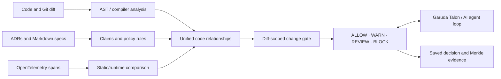

<p align="center">
  
</p>

<h1 align="center">Garuda</h1>

<p align="center">
  <strong>Let agents write. Garuda guards the architecture.</strong><br>
  <em>A local-first change-control gate, active AI execution harness, and software intelligence dashboard for AI-written code.</em>
</p>

<p align="center">
  <a href="https://github.com/myshra777-ai/garuda/actions/workflows/ci.yml"></a>
  <a href="https://github.com/myshra777-ai/garuda/actions/workflows/garuda-ci.yml"></a>
  <a href="https://github.com/myshra777-ai/garuda/actions/workflows/garuda-gate.yml"></a>
  
  <a href="LICENSE"></a>
  <a href="INSTALL.md"></a>
  <a href="EVIDENCE.md"></a>
</p>

Garuda helps engineering teams use AI coding agents without giving up control of their software architecture. It maps code relationships, evaluates proposed changes against architecture decisions and policy, blocks newly introduced violations, and records saved governance decisions as verifiable evidence.

**Works with:** Go, Python, and TypeScript repositories · Cursor, Claude Code, Codex, and Windsurf workflows · local dashboard/PWA · Git hooks and CI gates.

<p align="center">
  <a href="#watch-the-dashboard-demo">Watch the demo</a> ·
  <a href="#get-started">Get started</a> ·
  <a href="#how-garuda-works">How it works</a> ·
  <a href="#documentation">Documentation</a>
</p>

---

## Watch the Dashboard Demo

Explore Garuda's dashboard, architecture map, change-review workflow, Talon enforcement, and governance evidence.

<p align="center">
  <a href="assets/garuda_dashboard_demo_video.mp4" title="Open the Garuda dashboard demo video">
    
  </a>
  <br>
  <strong><a href="assets/garuda_dashboard_demo_video.mp4">▶ WATCH THE GARUDA DASHBOARD DEMO</a></strong>
</p>

The image above is a clickable poster for the existing video at `assets/garuda_dashboard_demo_video.mp4`. Commit `assets/garuda_dashboard_demo_thumbnail.jpg` alongside this README so GitHub can render the preview. Selecting the thumbnail or the link opens the video.

---

## The Problem: Passing Tests Is Not the Same as Preserving Architecture

AI coding agents can generate changes faster than a team can manually reason about their long-term impact. A change may pass its tests and linters while quietly introducing structural risk:

- **Layer bypass:** an HTTP handler calls a database repository directly instead of using the domain service (`CheckoutHandler → OrderRepository`).
- **Circular dependencies:** packages become coupled in a cycle (`auth → billing → users → auth`).
- **Unreviewed blast radius:** a shared function, class, or struct changes even though many downstream callers depend on it.
- **Architecture drift:** code diverges from the rules recorded in Architecture Decision Records (ADRs) or Markdown specifications.
- **Static/runtime disagreement:** runtime telemetry reveals a call that the declared architecture does not permit or the static graph does not explain.

Unit tests and linters are important, but they do not, by themselves, enforce the intended shape of a system. Garuda adds a deterministic architecture-aware review and enforcement layer around code changes.

## What Garuda Does

### 1. Maps code relationships

Analyzes Go, Python, and TypeScript code to identify symbols, calls, imports, implementations, and dependency relationships. Use the architecture map and impact tools to explore a focused neighborhood around a symbol instead of navigating an unreadable graph of the whole codebase.

### 2. Connects architecture documents to code

Ingests Markdown ADRs and evaluates documented `MUST` / `MUST_NOT` constraints alongside YAML policy rules, making architecture intent available during review and enforcement.

### 3. Reviews the change, not just the repository

The diff-scoped gate maps changed Git hunks to affected symbols, calculates their transitive blast radius, and distinguishes newly introduced violations from existing baseline issues. This helps teams add enforcement to established repositories incrementally.

### 4. Activates guardrails for AI agents

**Garuda Talon** provides pre-edit context, post-edit verification, IDE/agent integration, Git hooks, and a self-repair path when a change violates a rule. Instead of relying on an agent to remember to ask for architecture guidance, Talon makes the relevant contract part of the workflow.

### 5. Preserves evidence of governance decisions

Saved evaluations can be recorded in an append-only RFC 6962-style SHA-256 Merkle ledger, supporting inclusion checks and tamper-evident audit history for persisted governance records.

## Core Capabilities

| Capability | What it provides |
| --- | --- |
| **Garuda Talon** | Active agent harness with pre-edit briefing, post-edit verification, policy enforcement, and self-repair prompts. |
| **Diff-scoped change control** | Evaluates touched symbols and their blast radius, with a focus on newly introduced violations. |
| **Architecture map** | Explores callers, dependencies, implementations, and policy context around selected symbols. |
| **Docs-to-code verification** | Correlates ingested ADR claims and documented rules with the code structure. |
| **Runtime contradiction checks** | Can compare static relationships with ingested OpenTelemetry span evidence. |
| **Governance and audit ledger** | Records saved decisions and provides Merkle inclusion-proof verification. |
| **Local-first dashboard/PWA** | Presents engineering health, change review, policy state, contradictions, and audit evidence in focused surfaces. |
| **Universal setup and diagnostics** | Provides platform-specific one-command setup and `garuda doctor` health checks. |

## A Visual Tour of Garuda

Open the dashboard at `http://localhost:8080/dashboard` after setup. The dashboard is organized into focused engineering surfaces:

| Surface | Use it to |
| --- | --- |
| **Workspace Briefing** | Review workspace health, indexed entities, policy posture, active contradictions, recent decisions, and items needing attention. |
| **Architecture Map** | Explore a selected symbol's callers and dependencies, filter relationship types, and inspect source, relationships, policy results, and evidence. |
| **Change Review Workbench** | Preview change impact and policy outcomes before merging, including `ALLOW`, `WARN`, `REVIEW`, or `BLOCK` decisions. |
| **Policies** | Review deterministic policy predicates and test YAML policy rules. |
| **Contradictions & Evidence** | Investigate `CONTRADICTED` and `UNVERIFIED` claims, including relevant static locations and available runtime trace evidence. |
| **Governance & Audit Ledger** | Inspect saved governance records, decision context, and Merkle inclusion proofs. |

The dashboard is available in a browser and can be installed as a Progressive Web App (PWA) on supported desktop and mobile environments.

## How Garuda Works

Garuda combines code analysis, architecture intent, policy evaluation, active agent enforcement, and evidence. The graph is one part of the system—not the whole product.



### The evidence states

Garuda deliberately distinguishes different levels of evidence rather than treating every inferred relationship as equally certain:

- **`SUPPORTED`** — available static and/or runtime evidence corroborates the claim within the evaluated scope.
- **`UNVERIFIED`** — a static relationship or claim exists, but corroborating evidence has not been observed. This does not automatically mean the relationship is broken.
- **`CONTRADICTED`** — available evidence conflicts with a claim or policy, such as a forbidden dependency or an observed undeclared runtime call.

**Evidence boundary:** a Merkle ledger can support verification of the inclusion, ordering, and tamper-evidence of persisted governance records. It does not prove that every possible dynamic call has been observed, that a policy is well-designed, or that the code is free of bugs. Preview evaluations that are not saved are not anchored to the ledger.

## Garuda Talon: Active AI Agent Enforcement

Traditional tools may wait for an agent to request information. Garuda Talon brings the workspace's architecture contract into the coding workflow and checks changes as they are made.

Depending on the configured integration, Talon can:

1. Provide the agent with relevant ADR rules, YAML policies, and high-impact symbol context before edits.
2. Verify the resulting edits and evaluate the affected change against policies.
3. Block a change that violates an enforced rule and return structured feedback, including a self-repair prompt.
4. Connect governance checks to supported IDE/agent configurations, Git hooks, and CI workflows.

The documented integrations include **Cursor, Claude Code, Codex, and Windsurf**, along with Git pre-commit hooks and CI/CD gates. See the [Operational Playbook](PLAYBOOK.md) for workflow details.

## Get Started

Garuda's installer is designed to provision the required runtime components in user space. Under the documented setup path, you do not need to install Go, PostgreSQL, Docker, GCC, or Xcode first.

### macOS, Linux, Chromebook, and Android (Termux)

```bash
curl -fsSL https://raw.githubusercontent.com/myshra777-ai/garuda/main/install.sh | bash
```

To set up from a repository clone instead:

```bash
git clone https://github.com/myshra777-ai/garuda.git
cd garuda
./setup.sh
```

### Windows 10 / 11 (PowerShell)

Run in PowerShell. The remote installer does not require administrator privileges:

```powershell
Set-ExecutionPolicy Bypass -Scope Process -Force; irm https://raw.githubusercontent.com/myshra777-ai/garuda/main/install.ps1 | iex
```

To set up from an existing repository folder:

```powershell
cd $HOME\garuda
powershell -ExecutionPolicy Bypass -File .\setup.ps1
```

### Verify the setup

Open the dashboard at `http://localhost:8080/dashboard`. If something is misconfigured, run the repair command for your platform:

```bash
./bin/garuda doctor --fix
```

On Windows PowerShell:

```powershell
.\bin\garuda.exe doctor --fix
```

For platform-specific prerequisites, troubleshooting, and detailed instructions, see [`INSTALL.md`](INSTALL.md).

## A Typical Development Workflow

These commands illustrate the main workflow. Adjust the workspace name and paths for your repository.

```bash
# 1. Analyze a repository and save its baseline
./bin/garuda analyze . --workspace default --save

# 2. Ingest architecture decision records
./bin/garuda docs ingest ./docs/adr --workspace default

# 3. Brief on a high-impact symbol before changing it
./bin/garuda talon brief CheckoutHandler --workspace default

# 4. Gate the working-tree change
./bin/garuda talon guard --workspace default --fail-on-block
```

For a diff-focused check, use the command supported by your workflow, for example:

```bash
./bin/garuda check --diff HEAD --project default --policy ./policies --save --fail-on-block
```

When a change violates an active rule, the gate can return a `BLOCK` outcome with the relevant location, violated rule, and a concrete repair direction. See [`PLAYBOOK.md`](PLAYBOOK.md) for end-to-end examples and policy authoring.

## Language Support

| Language | Analysis approach described by the project | Stated status |
| --- | --- | --- |
| **Go** | Compiler-backed analysis using `go/types`, `go/ssa`, and workspace/module information. | Production |
| **Python** | Structural AST analysis including modules, classes, import aliases, and method-call relationships. | Production-ready |
| **TypeScript** | Tree-sitter and Pure-Go analysis paths for cross-file symbols and call relationships. | Production-ready |

See [`EVIDENCE.md`](EVIDENCE.md) for benchmark methodology, test results, and the explicit scope of the verification claims.

## MCP Tools and Integrations

The project documents **23 deterministic MCP tools** covering the following areas:

| Tool group | Examples of what agents can do |
| --- | --- |
| **Active enforcement** | Pre-edit briefing, post-edit verification, policy checks, and self-repair generation. |
| **Orientation and discovery** | Get workspace briefings, locate symbols, inspect entities, and query relationships. |
| **Topology and blast radius** | Trace callers and dependencies, find implementations/subclasses, and estimate transitive impact. |
| **Governance and policies** | List and evaluate policies, inspect governance status, and verify saved receipts. |
| **Evidence and drift** | Query claims, detect contradictions, and check documentation/code drift. |
| **Multi-agent continuity** | Hand off tasks and resume serialized checkpoints where configured. |

Exact tool names, configuration files, and API contracts are maintained in [`docs/API.md`](docs/API.md).

## Documentation

| Guide | Best for | Contents |
| --- | --- | --- |
| [`INSTALL.md`](INSTALL.md) | All users | One-command installation, supported platforms, setup details, and troubleshooting. |
| [`PLAYBOOK.md`](PLAYBOOK.md) | Engineering teams | Day-to-day operation, Talon workflows, policy authoring, ADR ingestion, and CI gates. |
| [`docs/WALKTHROUGH.md`](docs/WALKTHROUGH.md) | New users and evaluators | Guided tour of the dashboard and key CLI workflows. |
| [`docs/CAPABILITIES.md`](docs/CAPABILITIES.md) | Architects and technical evaluators | Capabilities, supported analysis, verification boundaries, and enforced invariants. |
| [`docs/API.md`](docs/API.md) | Tool and integration authors | CLI commands, MCP tools, policy syntax, and HTTP API endpoints. |
| [`docs/SPECS.md`](docs/SPECS.md) | Systems engineers and auditors | Architecture and implementation specifications. |
| [`EVIDENCE.md`](EVIDENCE.md) | Technical reviewers | Reproducible verification evidence, benchmark results, and scope limitations. |
| [`CHANGELOG.md`](CHANGELOG.md) | Everyone | Release history and notable changes. |
| [`LICENSE`](LICENSE) | Everyone | Apache 2.0 license terms. |

## Who It's For

- **Founders and engineering leaders** — see architecture health, high-risk dependencies, governance decisions, and areas needing attention in a visual dashboard.
- **Software engineers** — understand callers and blast radius before refactoring, and evaluate the change being introduced rather than taking responsibility for every legacy issue.
- **Staff and principal architects** — turn architecture decisions and policy rules into checks that can be applied in development workflows and CI.
- **AI coding agents** — receive workspace context and structured feedback to help avoid or repair changes that violate the repository's constraints.
- **Governance and security teams** — inspect persisted governance records and verify available cryptographic inclusion evidence.

## License

Garuda is released under the [Apache License 2.0](LICENSE).

<p align="center">
  <strong>Let agents write fast. Let Garuda keep the architecture whole.</strong>
</p>