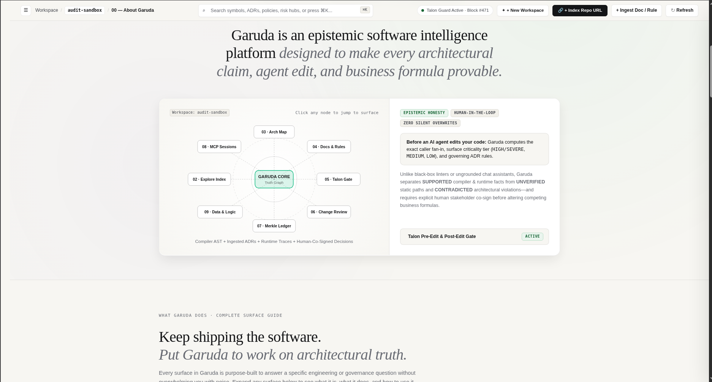

<p align="center">
  
</p>

<h1 align="center">Garuda</h1>

<p align="center">
  <strong>Know what a change affects before you merge it.</strong><br>
  Garuda checks every change your AI coding assistant makes against your system and your team's rules, before and after the edit. It runs on your machine and keeps proof of what was checked.
</p>

<p align="center">
  <a href="https://getgaruda.in"><strong>Website</strong></a> &nbsp;|&nbsp;
  <a href="https://getgaruda.in/#start">Get started</a> &nbsp;|&nbsp;
  <a href="https://getgaruda.in/#talk">Book a demo</a> &nbsp;|&nbsp;
  <a href="https://getgaruda.in/#faq">FAQ</a>
</p>

<p align="center">
  <a href="LICENSE"></a>
  <a href="server.json"></a>
  <a href=".claude-plugin/plugin.json"></a>
  <a href=".codex-plugin/plugin.json"></a>
  <a href="action.yml"></a>
  <a href="https://www.npmjs.com/package/garuda-guard"></a>
</p>

<p align="center">
  
</p>

---

## Why it exists

AI writes code faster than anyone can check it.

- **It can't see what depends on the code.** A three-line change can reach payments, reports and other services.
- **It doesn't know your rules.** Your team's decisions live in design docs and people's heads.
- **Nobody can show what was checked.** When something breaks, there is no record of what passed and why.

## How it works

1. **Before the edit,** Garuda tells the assistant what depends on the code, how critical it is and which of your rules apply.
2. **After the edit,** the change gets a verdict: **allow**, **warn**, **review** or **block**, with plain steps to fix what it broke. Problems that were already there are counted separately, so you only answer for what is new.
3. **At review,** each saved check becomes a tamper-evident receipt, and the pull request check stops a blocked change from merging.

## Why Garuda

| | Garuda | AI code review | Blast-radius tools | The assistant checking itself |
| :--- | :--- | :--- | :--- | :--- |
| Checks against your team's rules | **Yes**, drafted from your docs and approved by you | Some, through custom instructions | No | Only if it remembers them |
| Same answer every time | **Yes**, deterministic | No | Yes | No |
| When it checks | **Before and after every edit**, and on the pull request | At the pull request | When you run it | When it decides to |
| Says what it could not verify | **Yes**, in every verdict | Rarely | No | Rarely |
| Proof of what was checked | **Tamper-evident receipts** | Review comments | No | No |
| Where your code goes | **Nowhere.** It runs on your machine | Usually the vendor's cloud | Usually stays local | The model provider |

General categories; individual tools differ. Garuda works alongside AI code review rather than replacing it.

## Quick start

**Try it in one minute, no database:**

```bash
npx garuda-guard demo        # needs Node 18 or newer
```

**Install** (starts a local database and the dashboard, then prints your login):

```bash
# macOS and Linux
curl -fsSL https://raw.githubusercontent.com/myshra777-ai/garuda/main/install.sh | bash

# Windows (PowerShell)
Set-ExecutionPolicy Bypass -Scope Process -Force; irm https://raw.githubusercontent.com/myshra777-ai/garuda/main/install.ps1 | iex
```

Prefer to read it first? `git clone` this repository and run `./setup.sh` (or `setup.ps1`). Want your assistant to do it? [Copy the setup prompt](docs/INSTALL_WITH_AI.md).

**Point it at your project:**

```bash
garuda init . --wizard          # five short questions; also connects Claude Code, Claude Desktop and Cursor
garuda rulebook generate        # drafts rules from your code and docs for you to approve
garuda check . --diff HEAD      # checks what you just changed
```

Then open the dashboard at **http://localhost:8080/login**. If anything looks off, run `garuda doctor`.

The full walkthrough, with the dashboard tour, ready-made rule templates and importing rules from ArchUnit or Dependency-Cruiser, is in [`QUICKSTART.md`](QUICKSTART.md).

## Use it with your AI assistant

| Tool | How |
| :--- | :--- |
| **Claude Code** | `/plugin marketplace add myshra777-ai/garuda` then `/plugin install garuda@garuda` |
| **OpenAI Codex** | `codex plugin marketplace add myshra777-ai/garuda` |
| **Cursor** | `garuda init` writes the MCP settings into your project |
| **Any MCP client** | Run `garuda-mcp` over stdio ([example config](.mcp.json)) |

Your assistant gets **54 tools** (41 read-only) and **6 skills**: [`pre-edit-governance`](skills/pre-edit-governance/SKILL.md), [`change-impact`](skills/change-impact/SKILL.md), [`post-edit-verification`](skills/post-edit-verification/SKILL.md), [`violation-repair`](skills/violation-repair/SKILL.md), [`architecture-review`](skills/architecture-review/SKILL.md) and [`evidence-verification`](skills/evidence-verification/SKILL.md). The plugins need the `garuda-mcp` program and the local database, so install first.

## Check every pull request

Add the [GitHub Action](action.yml), or copy the ready-made workflow [`.github/workflows/garuda-gate.yml`](.github/workflows/garuda-gate.yml). Every pull request gets a verdict and a receipt, and a **BLOCK** fails the check. Make it a **required status check** in your repository settings, or people can still merge past it.

## Languages and limits

- **Go** is analysed with the compiler's own type checker. **Python, TypeScript and Java** are supported in beta.
- **It is not a cage.** An assistant can ignore advice and local hooks can be switched off. The required pull request check is the part that cannot be skipped.
- **Static analysis has edges.** Dynamic runtime behaviour is outside what it can see.
- **A receipt proves a record was not changed afterwards,** not that the analysis was complete.

See [`EVIDENCE.md`](EVIDENCE.md) for what was measured, on what, and when.

## Free and paid

The Garuda engine is free and open source under Apache 2.0, and stays that way. **Garuda Teams**, for organisations working across many repositories (routing, approvals, audit history), is in development. Early teams can join a free pilot: [book a demo](https://getgaruda.in/#talk).

## Talk to us

- **Questions and demos:** [getgaruda.in](https://getgaruda.in) or [contact@getgaruda.in](mailto:contact@getgaruda.in)
- **Help using Garuda:** [support@getgaruda.in](mailto:support@getgaruda.in), or [open an issue](https://github.com/myshra777-ai/garuda/issues)
- **Security reports:** see [`SECURITY.md`](SECURITY.md). Please do not open a public issue.

## Learn more

- [`QUICKSTART.md`](QUICKSTART.md): the full walkthrough
- [`docs/WHY_GARUDA.md`](docs/WHY_GARUDA.md): the business case in two minutes, for engineering leaders
- [`docs/TALON.md`](docs/TALON.md): how the before-and-after check works
- [`docs/DASHBOARD_WALKTHROUGH.md`](docs/DASHBOARD_WALKTHROUGH.md): every dashboard page
- [`docs/DATA_AND_LOGIC_AUDIT_GUIDE.md`](docs/DATA_AND_LOGIC_AUDIT_GUIDE.md): checks for numbers that disagree
- [`INSTALL.md`](INSTALL.md) · [`docs/API.md`](docs/API.md) · [`SECURITY.md`](SECURITY.md) · [`CONTRIBUTING.md`](CONTRIBUTING.md) · [`docs/adr/`](docs/adr/)

<p align="center">Released under the <a href="LICENSE">Apache 2.0 License</a>.</p>
