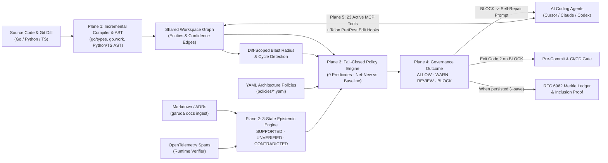

<p align="center">
  
</p>

<h1 align="center">Garuda</h1>

<p align="center">
  <strong>Let agents write. Garuda guards the architecture.</strong><br>
  <em>Zero-dependency change-control gate, active AI execution harness (<code>Garuda Talon</code>), and 6-surface software intelligence instrument for AI-written code.</em>
</p>

<p align="center">
  <a href="https://github.com/myshra777-ai/garuda/actions/workflows/ci.yml"></a>
  <a href="https://github.com/myshra777-ai/garuda/actions/workflows/garuda-ci.yml"></a>
  <a href="https://github.com/myshra777-ai/garuda/actions/workflows/garuda-gate.yml"></a>
  <a href="LICENSE"></a>
  <a href="INSTALL.md"></a>
  <a href="PLAYBOOK.md"></a>
  <a href="EVIDENCE.md"></a>
</p>

<p align="center">
  <a href="#the-problem-why-ai-written-code-breaks-architecture">The Problem</a> ·
  <a href="#1-command-universal-install-zero-dependencies">1-Command Install</a> ·
  <a href="#how-garuda-helps-every-role">Who It's For</a> ·
  <a href="#garuda-talon-active-agent-execution-harness">Garuda Talon Harness</a> ·
  <a href="#end-to-end-real-world-workflow">How to Use It</a> ·
  <a href="#why-the-graph-is-only-layer-1">5-Plane Architecture</a> ·
  <a href="#software-intelligence-instrument-dashboard-pwa">6-Surface Dashboard PWA</a> ·
  <a href="#23-active-mcp-tools-for-coding-agents">23 Active MCP Tools</a>
</p>

## The Problem: Why AI-Written Code Breaks Architecture

AI coding agents (**Cursor**, **Claude Code**, **Codex**, **Devin**, **Windsurf**) write code faster than humans can review it. A pull request can pass every unit test and linter check while quietly corroding your system architecture:

- **Silent Layer Bypass:** An HTTP handler starts calling or importing a database repository directly (`CheckoutHandler -> OrderRepository`) instead of going through the domain service layer.
- **Circular Package Coupling:** Three packages end up depending on each other in a cycle (`auth -> billing -> users -> auth`).
- **Blind Hub Modifications:** An agent modifies a core shared struct or class with 170+ transitive callers without checking downstream blast radius.
- **ADR & Runtime Drift:** Code contradicts documented Architecture Decision Records (ADRs), or production OpenTelemetry traces reveal runtime calls to unapproved services that do not exist in the static codebase.

Unit tests pass. The diff looks clean. A busy reviewer approves it. Six months later, nobody can change anything without breaking something else.

### What Garuda Is Now (v1.6 Universal)

**Garuda is a deterministic change-control gate, active AI execution harness (`Garuda Talon`), and 6-surface software intelligence instrument for Go, Python, and TypeScript codebases.**

Unlike passive code-graph indexers that wait for an agent to ask a question, Garuda actively governs the entire lifecycle of a code change:

1. **Zero-Dependency Universal Runtime (`v1.6`)** — Installs and launches in **1 command** on **Windows 10/11 (PowerShell)**, **macOS**, **Linux**, **Chromebook (ChromiumOS)**, and **Android (Termux / Chrome PWA)**. You do **not** need Go, PostgreSQL, GCC/Xcode/MinGW, or Docker pre-installed; Garuda automatically downloads or provisions a portable user-space toolchain and database, and compiles in 100% Pure-Go mode (`CGO_ENABLED=0`) when no C compiler is present.
2. **Garuda Talon Active Agent Harness (`garuda talon`)** — Turns passive MCP into an active, fail-closed harness. It compiles your live ADRs and YAML policies into `.garuda/TALON_CONTRACT.md`, injects rules into the agent's very first MCP tool call (`GARUDA_TALON_ENFORCE=true`), wires Cursor (`.cursor/rules/garuda-talon.mdc`), Claude Code (`PostToolUse` hook), Codex (`AGENTS.md`), Windsurf (`.windsurfrules`), and Git `pre-commit` hooks, and forces agents to self-repair when an edit violates architecture.
3. **Diff-Scoped Change-Control Gate (`garuda check --diff`)** — Maps `git diff` hunks (`--staged`, `--diff <rev>`, `--files`) directly to modified AST symbols, computes union transitive blast radius, and separates **net-new violations** introduced by your diff from legacy **baseline violations** so teams can adopt strict gates on brownfield repos immediately.
4. **3-State Epistemic Truth (`SUPPORTED` · `UNVERIFIED` · `CONTRADICTED`)** — Correlates static AST edges with Markdown ADRs (`garuda docs ingest`) and live OpenTelemetry trace spans (`POST /api/v1/telemetry/spans`). Shadow runtime calls or forbidden ADR dependencies are automatically quarantined as `CONTRADICTED`.
5. **6-Surface Software Intelligence Instrument (`/dashboard` PWA) & RFC 6962 Merkle Ledger** — A browser and standalone desktop/mobile Progressive Web App (`Briefing`, `Architecture Map`, `Change Review Workbench`, `Policies`, `Contradictions & Evidence`, `Governance & Audit Ledger`) backed by cryptographic RFC 6962 SHA-256 Merkle inclusion proofs.

## 1-Command Universal Install (Zero Dependencies)

Whether you are a **Product Manager**, **Founder**, **Architect**, or **Software Engineer**—**you do not need Go, PostgreSQL, GCC/Xcode, or Docker installed on your laptop**. Garuda manages everything automatically in user-space (`~/.garuda`):

### Windows 10 / 11 (PowerShell — No Admin, No Go, No Postgres, No GCC Required)

Open **Windows PowerShell** and paste:

```powershell
# Option A: 1-Command Remote Install & Launch (works even without Git, Go, Postgres, or Docker!)
Set-ExecutionPolicy Bypass -Scope Process -Force; irm https://raw.githubusercontent.com/myshra777-ai/garuda/main/install.ps1 | iex

# Option B: Inside an existing cloned or extracted garuda folder
cd $HOME\garuda
powershell -ExecutionPolicy Bypass -File .\setup.ps1
```

### macOS, Linux, Chromebook (Crostini) & Android (Termux)

Open **Terminal** and paste:

```bash
# Option A: 1-Command Remote Install & Launch
curl -fsSL https://raw.githubusercontent.com/myshra777-ai/garuda/main/install.sh | bash

# Option B: Inside an existing cloned or extracted garuda folder
git clone https://github.com/myshra777-ai/garuda.git && cd garuda && ./setup.sh
```

### Instant Self-Diagnostics & Auto-Repair (`garuda doctor`)

If anything is ever stopped, unlinked, or misconfigured on your machine, run one command to diagnose and auto-repair `.env`, PostgreSQL, binaries, MCP configs, and Talon hooks:

```bash
# macOS / Linux / Chromebook / Android
./bin/garuda doctor --fix

# Windows PowerShell
.\bin\garuda.exe doctor --fix
```

> 📖 **Full platform instructions (including Chromebook & Android PWA install) and a 13-item installation error guide:** see **[`INSTALL.md`](INSTALL.md)**.

## How Garuda Helps Every Role

| Who You Are | How Garuda Helps You | What You Run or Open |
|---|---|---|
| **Product Managers & Non-Technical Founders** | Install Garuda in 1 command without installing developer toolchains. Open the visual **Software Intelligence Instrument (`/dashboard`)** to see system health, high-risk coupling hubs, whether AI-written PRs respect documented product/architecture rules, and a plain-English audit trail of every governance decision. | Run `install.ps1` (Windows) or `install.sh` (Mac/Linux), then open `http://localhost:8080/dashboard` (or install it as a desktop/mobile PWA). |
| **Software Engineers** | See every direct and transitive caller, interface implementation, and active ADR/policy rule **before** you refactor a shared struct, class, or package—and check only your uncommitted git diff without being blocked by old legacy code. | Run `garuda talon brief <Symbol>`, `garuda check --diff HEAD`, or use the **Change Review Workbench** (`/dashboard#workbench`). |
| **Staff / Principal Architects** | Turn Markdown ADRs (`MUST` / `MUST_NOT`) and YAML layer/cycle/blast-radius policies into executable gates enforced automatically in Cursor, Claude Code, Git pre-commit, and CI/CD. | Author rules in `policies/*.yaml`, ingest ADRs via `garuda docs ingest`, and enforce with `garuda talon guard --fail-on-block`. |
| **AI Coding Agents (Cursor, Claude Code, Codex, Windsurf)** | Stop guessing via grep/RAG. Agents automatically receive your workspace's ADR & policy contract on their very first MCP call (`GARUDA_TALON_ENFORCE=true`) and use 23 deterministic tools for pre-edit blast radius, post-edit verification, and self-repair. | Automatic via `.cursor/mcp.json`, `.cursor/rules/garuda-talon.mdc`, `.claude/settings.json` (`PostToolUse` hook), and `AGENTS.md`. |
| **Security, Risk & Governance Leads** | Maintain an append-only, cryptographically verifiable RFC 6962 SHA-256 Merkle ledger of every saved architecture evaluation, policy outcome, and runtime OpenTelemetry contradiction. | Open **Governance & Audit Ledger** (`/dashboard#ledger`) or query `GET /api/v1/evidence/verify/{id}`. |

## Garuda Talon: Active Agent Execution Harness

Standard MCP servers are **passive**—if an AI coding agent chooses not to call a tool, it edits files blind and violates your architecture. **Garuda Talon (`garuda talon` / `bin/garuda-talon`) makes architectural governance active at all times** the moment `setup.sh`, `setup.ps1`, or `garuda init` runs:

| Enforcement Layer | What `garuda talon init` Configures Automatically | How It Forces Agent Compliance |
|---|---|---|
| **1. Active MCP Session Gate (`bin/garuda-mcp`)** | Exposes MCP `prompts/list` (`garuda.architectural_contract`), `resources/list` (`garuda://workspace/contract`, `garuda://workspace/adr-guardrails`), and active session injection (`GARUDA_TALON_ENFORCE=true`). | On the agent's very first MCP tool call, Garuda automatically injects the workspace's active ADR `MUST` / `MUST_NOT` rules and YAML policy guardrails into the response payload so the agent cannot miss them. |
| **2. Cursor Always-On Rule (`.cursor/rules/garuda-talon.mdc`)** | Compiles live ADRs (`document_claims`), YAML policies (`policies/*.yaml`), and top high-blast-radius hubs into `.garuda/TALON_CONTRACT.md` and `.cursor/rules/garuda-talon.mdc` (`alwaysApply: true`). | Forces Cursor agents to call `garuda.talon_pre_edit` before modifying files and `garuda.talon_verify_edit` immediately after editing. |
| **3. Claude Code Active Hooks (`.claude/settings.json` & `CLAUDE.md`)** | Writes `CLAUDE.md` and registers a `PostToolUse` hook on `Edit\|Write\|MultiEdit` in `.claude/settings.json` executing `garuda talon guard --hook` (Windows & POSIX path-safe). | Every time Claude Code edits a file, `garuda talon guard --hook` incrementally re-indexes the change and evaluates policies + ADRs. On `BLOCK`, it exits `2` and feeds a structured **Self-Repair Prompt** back to Claude. |
| **4. Codex / Aider / Windsurf (`AGENTS.md` & `.windsurfrules`)** | Maintains idempotent `<!-- GARUDA-TALON:START -->` contract blocks in `AGENTS.md` and `.windsurfrules`. | Ensures CLI and IDE agents share the exact same architectural rules and hub warnings. |
| **5. Git Pre-Commit & Provenance Hooks (`.git/hooks/`)** | Installs `.git/hooks/pre-commit` (`garuda talon guard --staged --fail-on-block`) and `.git/hooks/commit-msg`. | Blocks commits with net-new policy or ADR violations and stamps `Garuda-Governance-Outcome` and `Garuda-Merkle-Block` trailers into every verified commit message. |
| **6. Supervisor Loop (`garuda talon run -- <cmd>`)** | Wraps any autonomous CLI agent (`garuda talon run -- claude ...` or `garuda talon run -- aider ...`). | Intercepts working-tree edits after the agent runs, executes `talon guard`, and automatically loops the agent with the deterministic self-repair prompt (up to `--max-retries 3`) until `ALLOW` is achieved. |

## End-to-End Real-World Workflow

### Step 1: Index Any Go, Python, or TypeScript Repository (or Multi-Repo Workspace)

```bash
# Index a repository into a named workspace (creates an initial RFC 6962 Merkle baseline)
./bin/garuda analyze /path/to/my-repo --workspace my-system --save

# Or initialize the repo + Active MCP + Garuda Talon hooks in one command
./bin/garuda init /path/to/my-repo --workspace my-system
```

### Step 2: Ingest Markdown Architecture Decision Records (ADRs)

Turn human-written Markdown ADRs (`MUST` / `MUST_NOT` rules) into machine-verifiable claims:

```bash
./bin/garuda docs ingest ./docs/adr --workspace my-system
./bin/garuda docs verify --workspace my-system
```

### Step 3: Brief Yourself (or Your Agent) Before Touching a Core Symbol

```bash
./bin/garuda talon brief CheckoutHandler --workspace my-system
```

Output shows the exact symbol location, inbound caller count, transitive blast radius (`CRITICAL` / `HIGH` / `MEDIUM` / `LOW`), applicable ADR rules, and active YAML policies before a single line of code is edited.

### Step 4: Gate Your Uncommitted or Staged Diff (`garuda check` / `garuda talon guard`)

```bash
# Gate only the symbols touched in your current git diff (net-new violations only)
./bin/garuda check --diff HEAD --project my-system --policy ./policies --save --fail-on-block

# Or run the active Talon guard (auto-indexes dirty files + verifies ADRs & policies + emits Self-Repair instructions)
./bin/garuda talon guard --workspace my-system --fail-on-block
```

If an agent or developer introduces a forbidden dependency (for example, `CheckoutHandler -> OrderRepository`), Garuda returns `OUTCOME: BLOCK` (exit code `2`) and prints the exact file, line number, policy/ADR rule violated, and a concrete **Self-Repair Prompt** explaining how to refactor the change cleanly.

## Why the Graph Is Only Layer 1

Tools like knowledge-graph indexers stop at building a graph to help agents browse files. **In Garuda, the graph is Layer 1 — the product is the 5-plane active execution harness and deterministic change-control system built on top of it:**



- **Pure-Go Universal Portability (`CGO_ENABLED=0`):** Even when compiled without a C compiler (`CGO_ENABLED=0`), Garuda's TypeScript analyzer (`internal/ast/typescript/parser_nocgo.go`) and Python analyzer (`internal/ast/python`) extract full cross-file alias, class inheritance, `new Class()` instance, and method call graphs at `0.95` confidence alongside Go's `go/types` + `go.work` compiler engine at `1.0` confidence.
- **Edge-Level Runtime Contradiction Quarantine:** Garuda ingests OpenTelemetry trace spans (`POST /api/v1/telemetry/spans`) and promotes a static edge to `SUPPORTED` only when **both** caller and callee match at runtime—while automatically creating a `CONTRADICTED` quarantine record whenever production traffic makes an undeclared cross-service or cross-layer call.
- **Fail-Closed Governance by Design:** Malformed policy YAML, unknown predicates, or persistence failures never silently pass (`ALLOW`). Garuda fails closed so broken guardrails cannot wave bad changes through CI.

## Put the Gate in CI/CD

Garuda provides four purpose-built gates so you can enforce the exact failure mode your team requires in local Git hooks or GitHub Actions:

| Gate | Command | What It Enforces | Exit Behavior |
|---|---|---|---|
| **1. Active Talon Diff Gate** | `garuda talon guard --diff origin/main...HEAD --fail-on-block` | Incrementally syncs modified files, resolves touched AST symbols, checks ADR claims + YAML policies (net-new only), and outputs a self-repair plan on failure. | Exits `2` on `BLOCK` (`0` on `ALLOW`/`WARN`/`REVIEW`). |
| **2. Unified Change-Control Gate** | `garuda check --diff HEAD --project <ws> --policy ./policies --save --fail-on-block --json` | Runs all 5 planes across a symbol, file list (`--files`), staged index (`--staged`), or revision range (`--diff`) and seals an RFC 6962 Merkle receipt. | Exits `2` on `BLOCK` (`0` on `ALLOW`/`WARN`/`REVIEW`). |
| **3. Structural Regression Gate** | `garuda ci --baseline ./garuda-baseline.json --block-on-break` | Compares the current branch against a saved baseline snapshot to catch unintended signature breaks, removed exports, or structural regressions. | Exits non-zero when breaking structural changes are detected. |
| **4. Contradiction & Drift Gate** | `garuda ci check --fail-on-contradiction=true` | Verifies that documented architecture claims (`garuda docs ingest`) and runtime traces have zero active `CONTRADICTED` edges in the workspace. | Exits non-zero if any active contradiction exists. |

Start with the included [architecture layer guardrails policy](policies/architecture-layer-guardrails.yaml) and the full [CLI & Policy Reference](docs/API.md).

## Software Intelligence Instrument (`/dashboard` PWA)

Garuda ships a high-craft web instrument at `http://localhost:8080/dashboard` (installable as a standalone **Progressive Web App** on Windows, macOS, Linux, Chromebook, and Android via `/manifest.json` and `/sw.js`) inspired by Linear, Vercel, Sentry, and Neo4j Bloom—replacing noisy full-graph hairballs with 6 focused engineering surfaces and a global `⌘K` / `Ctrl+K` command palette:

1. **Workspace Briefing (`/dashboard#briefing`)** — Clean status strip and health KPIs (Indexed Entities, Policy Posture, Active Contradictions, Merkle Ledger Head) paired with an actionable Needs-Attention queue and recent governance verdicts.
2. **Architecture Map (`/dashboard#map`)** — **Neighborhood-first 1-hop / 2-hop topology explorer** (`[Selected Caller] ──> [Focal Symbol] ──> [Direct Dependency / Policy Badge]`) with interactive hop-depth (`1 hop`, `2 hops`) and edge-kind filters (`Calls`, `Imports`, `Implements`, `Claims`) plus a synchronized 4-tab Inspector Drawer (`Source`, `Relationships`, `Policy Results`, `Evidence`).
3. **Change Review Workbench (`/dashboard#workbench`)** — 3-pane pre-merge simulator: select a target symbol and policy bundle on the left, inspect impacted callers and policy rules in the center, and generate a live `ALLOW` / `WARN` / `REVIEW` / `BLOCK` governance gate receipt on the right.
4. **Policies (`/dashboard#policies`)** — Interactive catalog of all 9 deterministic SQL/CTE policy predicates alongside a live YAML Policy Sandbox to test rules before committing them to CI.
5. **Contradictions & Evidence (`/dashboard#contradictions`)** — Sentry-style forensic queue for `CONTRADICTED` and `UNVERIFIED` claims, comparing static AST location against live OpenTelemetry runtime trace spans (`trace_id`, `span_id`, service pair) plus an interactive OTel Span Simulator.
6. **Governance & Audit Ledger (`/dashboard#ledger`)** — Append-only decision table with a bottom **Decision Record Inspector** (`What it did`, `What it looked at`, `What rule applied`, `Epistemic state`, `RFC 6962 Merkle Inclusion Proof`) and 1-click cryptographic verification.

## 23 Active MCP Tools for Coding Agents

`./setup.sh` and `.\setup.ps1` automatically register `garuda-mcp` with **Cursor** and **Claude Desktop** with `GARUDA_TALON_ENFORCE=true` enabled by default. Connected agents receive live MCP Prompts (`garuda.architectural_contract`), MCP Resources (`garuda://workspace/contract`), and 23 deterministic tools:

| Category | MCP Tools | Purpose |
|---|---|---|
| **Active Talon Enforcement** | `garuda.talon_pre_edit`, `garuda.talon_verify_edit` | Mandatory pre-edit blast-radius/ADR briefing and post-edit incremental re-index + diff-scoped policy verification + self-repair generator. |
| **Orientation & Discovery** | `garuda.briefing`, `garuda.entities`, `garuda.find_entity`, `garuda.inspect`, `garuda.query` | Orient the agent to workspace health, resolve exact symbol IDs ranked by inbound edges, and inspect relationships before editing. |
| **Topology & Blast Radius** | `garuda.neighbors`, `garuda.blast_radius`, `garuda.implementers`, `garuda.subclasses`, `garuda.get_impact`, `garuda.get_lineage` | Trace upstream callers, downstream dependencies, interface implementations, class hierarchies, and transitive change impact. |
| **Governance & Policy Gates** | `garuda.policy.list`, `garuda.policy.evaluate`, `garuda.verify_policy_evaluation`, `garuda.governance.status`, `garuda.propose_decision` | Pre-check proposed refactors against active YAML policies and verify RFC 6962 Merkle receipts. |
| **Epistemic Truth & Drift** | `garuda.detect_contradictions`, `garuda.check_drift`, `garuda.query_claims` | Query static-vs-runtime contradictions, ADR `document_claims`, and documentation-to-code drift. |
| **Multi-Agent Continuity** | `garuda.handoff`, `garuda.resume` | Atomically transfer task ownership and restore serialized checkpoints across multi-agent sessions. |

### Complete CLI Command Surface

- `garuda init <repo-path> --workspace <name>` — Initialize Postgres, migrations, owner account, Active MCP, and Garuda Talon hooks in 1 command.
- `garuda doctor [--fix] [--json]` — Diagnose and auto-repair `.env`, PostgreSQL, binaries, MCP config, and Talon hooks across Windows, macOS, Linux, Chromebook, and Android.
- `garuda talon <init|contract|brief|guard|run>` (or `garuda-talon ...`) — Manage the active AI execution harness, inspect compiled ADR/policy contracts, gate working-tree diffs, or supervise agent commands.
- `garuda analyze <path> [--incremental] [--files a.go,b.go] [--save]` — Run full or incremental compiler-backed Go (`go/types` + `go.work`), Python, and TypeScript AST extraction.
- `garuda check [--diff <rev> | --staged | --files <csv> | --target <sym>] [--net-new-only] [--save] [--fail-on-block]` — Turn a symbol or git diff into an evidence-backed governance decision.
- `garuda impact --target <symbol>` — Compute confidence-weighted transitive blast radius from the terminal.
- `garuda policy evaluate --policy <dir>` — Evaluate YAML architecture policies across the active workspace.
- `garuda docs <ingest|verify|status>` — Extract architectural claims from Markdown/ADRs and verify them against code.
- `garuda hygiene` (alias `garuda ponytail`) — Detect structural dead-ends, orphaned symbols, and architectural drift.
- `garuda topology` & `garuda summary` — Inspect package-level layering, hub centrality, and workspace metrics.

## Evidence, Not False Certainty

Garuda keeps the boundaries of its evidence explicit so teams never mistake a clean check for magical omniscience:

- **`SUPPORTED`** — Available static and/or runtime evidence corroborates the claim within the verified scope.
- **`UNVERIFIED`** — Static structure exists, but runtime or secondary corroborating evidence has not yet been observed. It does *not* mean the relationship is broken.
- **`CONTRADICTED`** — Available evidence actively conflicts with a claim (for example, an ADR states `CheckoutHandler` must not call `OrderRepository`, or an OpenTelemetry span observes an undeclared runtime call).

**What the RFC 6962 Merkle Ledger Proves (and What It Doesn't):**
The Merkle ledger cryptographically proves the **inclusion, ordering, and tamper-evidence of persisted governance records** (`--save`). It does **not** prove that an unindexed dynamic call cannot exist, that a human-written YAML policy is wise, or that the software is bug-free. Preview evaluations run without `--save` are ephemeral and are not anchored to the ledger.

## Supported Languages & Verification Benchmarks

| Language | Analysis Engine | Confidence & Scope | Status |
|---|---|---|---|
| **Go** | `go/types`, `go/ssa`, `go.work`, `vendor/` | Exact compiler-grade type, interface, and cross-module call resolution (`1.0` static confidence). | **Production** |
| **Python** | Structural + Alias/Receiver AST Analyzer | Module, class, function, `import X as Y` / `from X import Y as Z` alias, and instance method call-graph resolution (`0.95` static confidence). | **Production-Ready** |
| **TypeScript** | Tree-sitter (CGO) + Pure-Go Lexical/Scope AST Analyzer (`!cgo`) | Interface, class, function, named/namespace import alias, `new Class()` instance, and cross-file call-graph resolution (`0.95` static confidence, works even with `CGO_ENABLED=0`). | **Production-Ready** |

- **Reproducible Verification Suite:** `make benchmark-strict` executes 24 ground-truth compiler and cross-module benchmarks (`TestDoubleRunDeterminism` across all 24 cases), `30/30` reference MCP & Talon active verifier checks (`scripts/mcp_verify.py`), and `10/10` edge-level runtime contradiction detections (`scripts/runtime_contradiction_test.py`). See [EVIDENCE.md](EVIDENCE.md) for full methodology and scope boundaries.

## Documentation

- **[Universal Installation & Troubleshooting Guide (`INSTALL.md`)](INSTALL.md)** — 1-command zero-dependency setup for Windows PowerShell, macOS, Linux, Chromebook (ChromiumOS), and Android (Termux & Chromium PWA), plus the 13-item installation & Git troubleshooting table.
- **[Operational Playbook (`PLAYBOOK.md`)](PLAYBOOK.md)** — Complete day-to-day operational guide: zero-dependency onboarding, Garuda Talon harness workflows, diff-scoped `garuda check`, policy authoring, ADR ingestion, runtime OpenTelemetry verification, and CI/CD gates.
- **[System Walkthrough (`docs/WALKTHROUGH.md`)](docs/WALKTHROUGH.md)** — Guided tour of all 7 Garuda v1.6 surfaces (`setup.sh`/`setup.ps1`, `garuda doctor`, `garuda talon`, `garuda check`, 6-surface `/dashboard` PWA, 23-tool MCP server, and VS Code extension).
- **[Capabilities & Verification Matrix (`docs/CAPABILITIES.md`)](docs/CAPABILITIES.md)** — Detailed breakdown of all 6 planes, verification guarantees, and enforced invariants.
- **[CLI, Policy, MCP & HTTP API Reference (`docs/API.md`)](docs/API.md)** — Complete reference for all CLI commands (`init`, `doctor`, `talon`, `check`, `analyze`, `policy`, `docs`), 9 policy predicates, 23 MCP tools, and REST/PWA endpoints.
- **[System Specifications (`docs/SPECS.md`)](docs/SPECS.md)** — Architecture internals, PostgreSQL schema, Ed25519 JWT auth, and RFC 6962 Merkle tree specifications.
- **[Verification Evidence (`EVIDENCE.md`)](EVIDENCE.md)** — Reproducible benchmark output, test coverage, cross-OS `CGO_ENABLED=0` build matrix, and explicit security/epistemic boundaries.
- **[Changelog (`CHANGELOG.md`)](CHANGELOG.md)** · **[Codebase Hygiene (`docs/hygiene.md`)](docs/hygiene.md)** · **[License (Apache 2.0)](LICENSE)**
