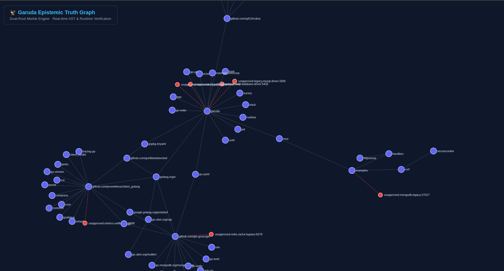
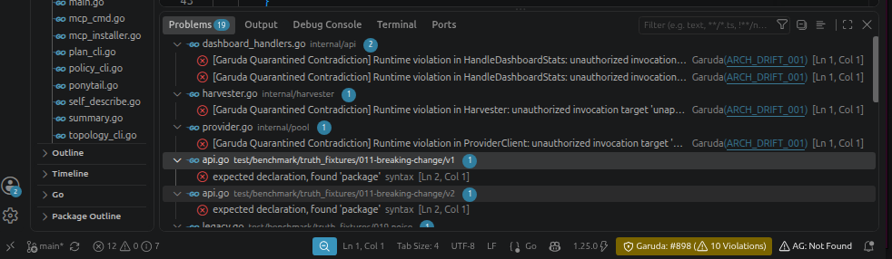

# Garuda System Walkthrough (`v1.8.1` Universal)

**A complete visual and technical tour of Garuda's 8-surface Software Intelligence Instrument (`/dashboard` PWA), the `Garuda Talon` active AI execution harness, deterministic `BuildContext` provenance receipts, cross-platform `--matrix` gates, 23 active MCP tools, and IDE integrations.**

---

## 0. Watch the 23-Second Dashboard Demo

The current dashboard demo is 22.7 seconds long. Its preview uses a screenshot already tracked in `../assets/`; click the image or the link to open the MP4.

<p align="center">
  <a href="../assets/garuda_dashboard_demo_video.mp4" title="Play the Garuda dashboard demo">
    
  </a>
  <br>
  <strong><a href="../assets/garuda_dashboard_demo_video.mp4">▶ Open the Garuda dashboard demo (MP4)</a></strong>
</p>

---

## 1. One-Command Zero-Dependency Universal Setup (`install.sh` / `install.ps1`)

Garuda `v1.8.1` eliminates manual toolchain downloads, manual SQL migration loops, manual JWT key generation, and passive MCP configuration. Whether you are on Windows 10/11, macOS (Apple Silicon or Intel), Linux, Chromebook (Crostini), or Android (Termux), Garuda provisions its own portable runtime in user-space (`~/.garuda`) and boots in one command:

### macOS, Linux, Chromebook (Crostini) & Android (Termux)
```bash
# Remote 1-command install & launch
curl -fsSL https://raw.githubusercontent.com/myshra777-ai/garuda/main/install.sh | bash

# Or inside a local repository
./setup.sh
```

### Windows 10 / 11 (PowerShell)
```powershell
# Remote 1-command install & launch
Set-ExecutionPolicy Bypass -Scope Process -Force; irm https://raw.githubusercontent.com/myshra777-ai/garuda/main/install.ps1 | iex

# Or inside a local repository
powershell -ExecutionPolicy Bypass -File .\setup.ps1
```

### What Happens Automatically Under the Hood
1. **Zero-Admin Portable Toolchain & Database**: If Go or PostgreSQL are not installed on your device, Garuda downloads Portable Go 1.24 and Portable PostgreSQL 16 into `~/.garuda/`, initializes a local database cluster on port `5433`, and compiles all four binaries (`garuda`, `garuda-api`, `garuda-mcp`, `garuda-talon`) using `CGO_ENABLED=0` Pure-Go mode when no C compiler (`gcc`/`clang`) is present.
2. **Dynamic Identity & Persistent `.env`**: Reads your identity from `git config`, runs all SQL migrations idempotently, and persists `DATABASE_URL`, `GARUDA_WORKSPACE`, `GARUDA_TALON_ENFORCE=true`, `PORT=8080`, and Ed25519 JWT keys into `.env`.
3. **Garuda Talon Active Agent Harness (`garuda talon init`)**: Compiles live workspace ADRs (`document_claims`), declarative YAML policies (`policies/*.yaml`), and top high-blast-radius hubs into `.garuda/TALON_CONTRACT.md`, `.cursor/rules/garuda-talon.mdc`, `.cursor/mcp.json`, `CLAUDE.md`, `.claude/settings.json` (`PostToolUse` hook), `AGENTS.md`, `.windsurfrules`, and `.git/hooks/pre-commit`.

---

## 2. Visual Tour of the 8-Surface Software Intelligence Instrument (`/dashboard` PWA)

Open `http://localhost:8080/dashboard` (or install it as a standalone desktop/Chromebook/Android Progressive Web App via `/manifest.json` and `/sw.js`). Every chart and graph uses Garuda's built-in **Zero-CDN Offline SVG Layout Engine** so it works 100% air-gapped.

### Surface 01 — Executive Workspace Briefing (`/dashboard#briefing`)
Provides an immediate system health strip (Indexed Entities, Verified Edges, Active Policy Posture, Contradictions Count, and RFC 6962 Merkle Head), a prioritized **Needs Attention** queue, and recent governance verdicts.

<p align="center">
  
</p>

### Surface 02 — Explore Index & High-Impact Symbol Directory (`/dashboard#explore`)
Automatically loads the workspace's top exported symbols ranked by inbound caller fan-in and blast radius on initial boot. Engineers can filter by language (`Go`, `Python`, `TypeScript`), entity kind (`struct`, `interface`, `func`, `method`, `class`, `package`), or press `⌘K` / `Ctrl+K` from anywhere to jump straight to a symbol.

<p align="center">
  
</p>

### Surface 03 — Neighborhood-First Architecture Map (`/dashboard#map`)
Replaces unreadable 10,000-node hairballs with a focused **1-hop or 2-hop ego-network explorer** (`[Upstream Callers] ──> [Focal Symbol] ──> [Downstream Dependencies & Policy Badges]`). Clicking any node opens the synchronized **4-Tab Inspector Drawer** (`Source`, `Relationships`, `Policy Results`, `Evidence`), and toggling **`✦ Docs & Rules Graph`** overlays normative ADR/spec links directly onto the map.

<p align="center">
  
</p>

### Surface 04 — Docs, Specs & Guardrails Lineage Graph (`/dashboard#docs-graph`)
Introduced in `v1.7` and refined in `v1.8.1`, this surface visualizes how human-written engineering standards govern live code across a **4-tier DAG**:
- **Tier 1 — Documents**: Markdown ADRs (`docs/adr/*.md`), Design Specs (`docs/specs/*.md`), System Invariants (`docs/invariants.md`), YAML Policy Bundles (`policies/*.yaml`), and `.garudarules`.
- **Tier 2 — Extracted Normative Rules**: Machine-extracted `MUST`, `MUST_NOT`, `BLOCK`, `REVIEW`, `DENY`, and `INVARIANT` claims.
- **Tier 3 — Active Policy Guardrails**: Executable SQL/CTE predicates enforcing those rules.
- **Tier 4 — Code Symbols & Packages**: The exact Go, Python, and TypeScript symbols bound by each rule, complete with a **Document-to-Code Component Matrix** and an in-browser **Ingest Document / ADR Modal** (`POST /api/v1/dashboard/docs-ingest`).

<p align="center">
  
</p>

### Surface 05 — Garuda Talon & Architectural Risk Hub (`/dashboard#talon-hub`)
The operational nerve center for AI agent governance and build-context determinism (`v1.8.1`):
- **Deterministic `BuildContext` Provenance Receipt & CI-vs-Editor Drift Banner**: Displays the active `receipt_hash`, `graph_fingerprint`, `GOOS/GOARCH`, `CGO_ENABLED`, `-tags`, `go.mod` hash, dirty worktree state, drift status (`CLEAN` vs `DRIFT DETECTED`), and a 1-click **Copy Reproduce Cmd** button.
- **Cross-Platform Build Matrix Gate (`--matrix`)**: Shows real-time verification across `linux/amd64 (cgo=0)`, `linux/amd64 (cgo=1, tags=cgo)`, `darwin/arm64 (cgo=1)`, and `windows/amd64 (cgo=0)`.
- **Live Talon Active Guard Terminal**: Run diff-scoped `talon guard` checks or simulate an architectural violation to inspect the exact **Self-Repair Prompt** fed back to Cursor/Claude Code.
- **Active IDE, MCP & Git Hook Status Panel**: Tracks all 6 enforcement hooks with 1-click installation/sync.
- **Architectural Risk Hub Leaderboard**: Scores symbols from `0–100` (`CRITICAL`, `HIGH`, `MEDIUM`, `LOW`) by caller fan-in, transitive blast radius, and ADR sensitivity, with 1-click **Pre-Edit Briefing** drawers.

<p align="center">
  
</p>

### Surface 06 — Change Review Workbench & Interactive Policy Sandbox (`/dashboard#workbench` & `/dashboard#policies`)
A 3-pane pre-merge simulator where engineers select a target symbol and policy bundle on the left, inspect impacted upstream callers and applicable predicates in the center, and generate a live `ALLOW` / `WARN` / `REVIEW` / `BLOCK` receipt on the right—paired with a live YAML Policy Sandbox for testing new rules across all 9 graph predicates.

<p align="center">
  
</p>

### Surface 07 & 08 — Forensic Contradictions Queue & RFC 6962 Cryptographic Audit Ledger (`/dashboard#contradictions` & `/dashboard#ledger`)
- **Contradictions & Evidence (`#contradictions`)**: Compares static AST source locations against live OpenTelemetry runtime trace spans (`trace_id`, `span_id`, caller/callee service pair) and includes an interactive **OTel Runtime Span Simulator** to test shadow-call quarantine.
- **Governance & Audit Ledger (`#ledger`)**: Displays the append-only RFC 6962 SHA-256 Merkle ledger table with a bottom **Decision Record Inspector** (`What it did`, `What it looked at`, `BuildContext Receipt`, `Epistemic state`, `Merkle Inclusion Proof`) and 1-click cryptographic verification.

<p align="center">
  
</p>

---

## 3. Deterministic `BuildContext` Receipts & Cross-Platform Matrix CLI (`v1.8.1`)

One of the hardest problems in static analysis and architectural governance is **environment drift**: a developer runs a check on `darwin/arm64` with `CGO_ENABLED=1`, while CI runs on `linux/amd64` with `CGO_ENABLED=0` or custom `-tags`.

In `v1.8.1`, every `garuda analyze`, `garuda check`, and `garuda talon guard` execution computes and seals a deterministic **`BuildContext` receipt**:

```bash
# Re-index workspace with a sealed v1.8.1 BuildContext receipt and Merkle block
./bin/garuda analyze . --workspace default --save

# Run the active Talon guard across your current git diff AND verify all 4 OS/CGO target profiles
./bin/garuda talon guard --workspace default --matrix --fail-on-block
```

Example terminal output:
```text
🔒 Garuda Talon Active Guard (v1.8.1)
   Workspace:         default
   Build Receipt:     bc_9f82d4a1e7c03b12 (graph: gf_4e19a82c01b7d3ef)
   Target Env:        linux/amd64 | CGO_ENABLED=0 | tags=[] | go1.24
   Environment Drift: CLEAN (matches indexed workspace graph receipt)
   Cross-OS Matrix:   [PASS] linux/amd64 (cgo=0) | [PASS] linux/amd64 (cgo=1) | [PASS] darwin/arm64 (cgo=1) | [PASS] windows/amd64 (cgo=0)
   Reproduce Command: CGO_ENABLED=0 GOOS=linux GOARCH=amd64 ./bin/garuda talon guard --workspace default --diff HEAD --fail-on-block
   Governance Verdict: ALLOW ✓ (0 net-new violations; baseline isolated)
```

---

## 4. VS Code & Cursor IDE Extension (`vscode-extension/`)

Alongside the 23-tool MCP server and `.cursor/rules/garuda-talon.mdc` harness, Garuda ships a native VS Code / Cursor extension providing inline neighborhood graph inspection and live contradiction diagnostics right next to your code editor:

| IDE Graph View (`../assets/screenshots/ide-graph-view.png`) | IDE Contradictions Panel (`../assets/screenshots/ide-contradictions.png`) |
| :---: | :---: |
|  |  |
