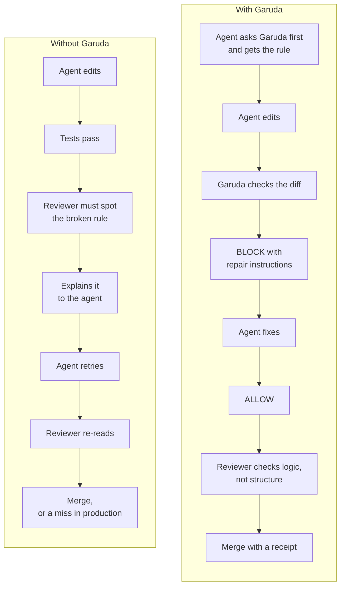

# Why Garuda: the two-minute version for engineering leaders

**AI agents now write a large share of your code, and delivery stability falls as AI adoption rises ([DORA 2024](https://cloud.google.com/blog/products/devops-sre/announcing-the-2024-dora-report)).**
Garuda checks every AI change against your architecture and business rules, blocks what breaks them, and tells the agent how to fix it.
You can see it work on your laptop with one command: `./bin/garuda demo`.

---

## 1. What an unchecked AI change costs

AI changes usually pass the tests. The damage is in what the tests don't check.

| What goes wrong | What it looks like | What it costs you |
| :--- | :--- | :--- |
| A layer is skipped | The payment handler talks to the database directly. Tests pass. | A refactor later, after other code depends on the shortcut |
| A number changes scale | One report divides by `1e8`, another by `1e7`. `48 Cr` becomes `4.8 Cr`. | Wrong numbers in front of customers or finance |
| An old decision is broken | A design record says "no direct calls to the ledger service". The agent never read it. | The decision silently stops being true |
| Review becomes the bottleneck | Senior engineers re-read every AI diff for structure, not just logic | Their time, and slower merges |
| Sensitive data takes a new path | Personal data logged, or sent to a new service | Breach exposure: $4.44M average globally, $10.22M in the US ([IBM 2025](https://cyberscoop.com/ibm-cost-data-breach-2025/)) |

What the research says:

- **66%** of developers spend more time fixing AI code that is "almost right, but not quite" ([Stack Overflow 2025](https://stackoverflow.blog/2025/07/29/developers-remain-willing-but-reluctant-to-use-ai-the-2025-developer-survey-results-are-here)).
- In a randomized trial, experienced developers took **19% longer** with AI tools while believing they were **20% faster** ([METR 2025](https://simonwillison.net/b/8833)). What feels fast is not always fast.
- About **two in three** organisations have no policy governing AI ([IBM 2025](https://cyberscoop.com/ibm-cost-data-breach-2025/)).

## 2. Do your own math

We will not guess your numbers. Here is the formula:

```text
yearly cost of structural fixes to AI changes
  = engineers
  × AI pull requests per engineer per week
  × 50 weeks
  × share of those pull requests that need a structural fix
  × hours per fix
  × loaded cost per engineering hour
```

**Illustrative — replace with your numbers.** 50 engineers × 3 AI pull requests a week × 50 weeks × 10% needing a structural fix × 2 hours × $80 an hour = **$120,000 a year**, before counting anything that reaches production.

Garuda's job is to move those fixes out of human review and production, and into the agent's own retry, before anyone else reads the code.

## 3. Before and after



Without Garuda, a person finds the problem, explains it and checks the fix. With Garuda, the agent finds out and fixes it itself. The reviewer is left with the question only a person can answer: is this the right change?

## 4. How it compares

Most teams already use some of these tools. Garuda works alongside them.

| | Architecture rule tools (ArchUnit, Dependency-Cruiser, Import Linter) | Static scanners (Semgrep, Snyk) | AI code reviewers (CodeRabbit, Greptile) | Garuda |
| :--- | :--- | :--- | :--- | :--- |
| Enforces layer and dependency rules | Yes, one language each | With custom rules | As written guidelines, judged by an AI model | Yes: Go, Python, TypeScript |
| How it decides | Fixed rules | Fixed rules | AI model's judgment | Fixed rules on the code's structure |
| Briefs the agent **before** it edits | No | No | No (reviews the pull request) | Yes |
| Separates new problems from old ones | Yes, with a saved baseline | Yes, diff-aware scans | Reviews the diff only | Yes |
| Turns written design decisions into rules | No | No | Partly, via guideline files | Yes, after a human approves them |
| Tamper-evident record of checks | No | No | No | Yes, for saved checks |
| Free, self-hosted core | Yes | Semgrep Community Edition; Snyk free tier | Hosted, with free tiers | Yes (Apache 2.0) |

*Other tools' columns as of November 2026, from their public documentation. Tell us if one is out of date.*

These tools are good at what they do. Garuda can import your existing ArchUnit, Dependency-Cruiser and Import Linter rules (`garuda import`), so you keep the work you have already done.

## 5. What Garuda is not

- **Not a sandbox.** An agent can ignore advice. The check that cannot be skipped is a required status check on your pull requests, which takes one setting in GitHub.
- **Not equally deep in every language.** Go is read with the compiler's type information. Python and TypeScript are read by code structure.
- **Not a log of everything.** Only saved checks are sealed in the tamper-evident record. It proves a record was not changed. It does not prove the analysis was complete.

## 6. Try it, then talk

```text
./bin/garuda demo              three planted bugs, listed and explained (no database needed)
./bin/garuda init . --wizard   five questions, then your own rules on your own code
```

**Want to see what your agents are changing?** [Open an issue](https://github.com/myshra777-ai/garuda/issues/new/choose) and ask for an architecture scan. We help you run Garuda on your own repository, on your machine or in your CI, so your code does not leave your hands. You get a report of the rules your code breaks today and which parts are most at risk.

Garuda is free and open source (Apache 2.0). Start with the [README](../README.md), or read [how the before-and-after check works](TALON.md).
